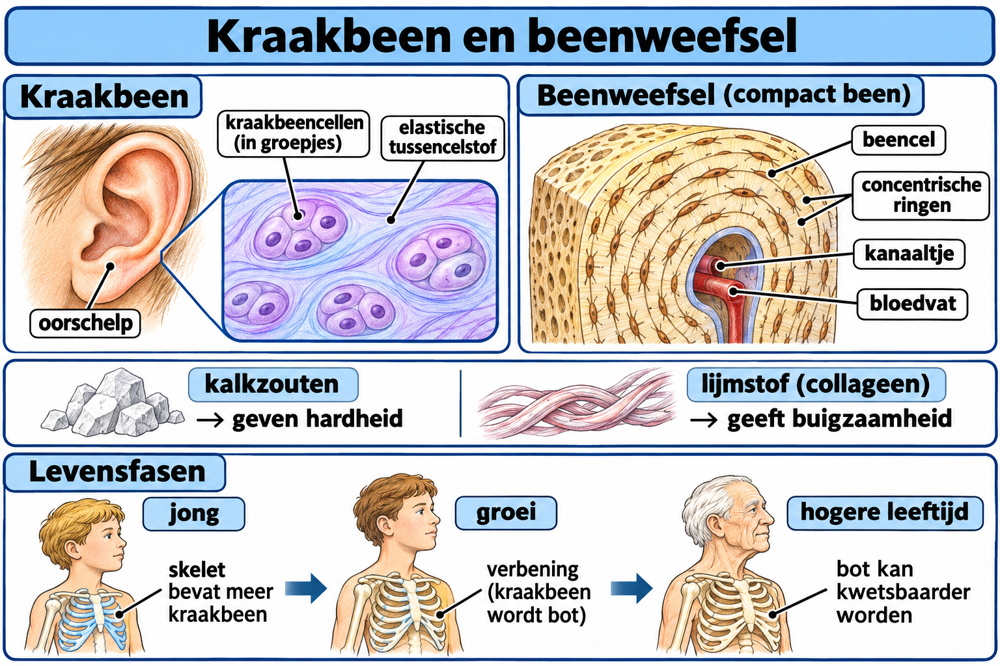

# Thema 4 Stevigheid en beweging  
## Basisstof 2 Kraakbeenweefsel en beenweefsel  

---

### Samenvatting

Je skelet moet stevig zijn, maar ook een beetje kunnen buigen. Dat kan dankzij twee soorten weefsel: beenweefsel en kraakbeenweefsel. In deze les leer je wat de verschillen zijn tussen deze twee weefsels en hoe botten veranderen tijdens je leven.

---

### Lesdoelen

**Concept:** Beenweefsel, kraakbeenweefsel en botsamenstelling.

**Vaardigheid:** Vergelijken en verbanden verklaren.

Je kunt aan het einde van de les beenweefsel en kraakbeenweefsel vergelijken en uitleggen hoe botsamenstelling en leeftijd de eigenschappen van botten beïnvloeden.

<!--
- Je kunt kenmerken noemen van beenweefsel en kraakbeenweefsel.  
- Je kunt uitleggen wat kalkzouten en lijmstof doen.  
- Je kunt beschrijven hoe botten veranderen van baby tot oudere.  
-->

---

### Lesinhoud

Twee weefsels zorgen samen voor stevigheid in het skelet:

- **Beenweefsel**
- **Kraakbeenweefsel**

#### Beenweefsel

Beenweefsel is:
- heel stevig  
- bijna niet buigzaam  

In beenweefsel zitten:
- botcellen  
- tussencelstof  
- kalkzouten  
- lijmstof  

**Kalkzouten** zorgen ervoor dat botten hard zijn.  
**Lijmstof** zorgt ervoor dat botten een beetje kunnen buigen.  

Samen zorgen kalkzouten en lijmstof voor stevigheid.

#### Kraakbeenweefsel

Kraakbeenweefsel is:
- stevig  
- buigzaam  

In kraakbeenweefsel zitten:
- kraakbeencellen  
- tussencelstof  
- kalkzouten  
- lijmstof  

Kraakbeen komt bijvoorbeeld voor:
- in de oorschelpen  
- in de neus  
- tussen borstbeen en ribben  
- tussen de wervels  

Deze plaatsen moeten stevig én soepel zijn.

---

### Veranderingen tijdens het leven

Botten veranderen tijdens je leven.

**Bij baby’s**
- Het skelet bestaat bijna helemaal uit kraakbeenweefsel.

**Bij kinderen**
- Er zit veel lijmstof in de botten.
- Daardoor zijn botten buigzaam.

**Bij volwassenen en ouderen**
- Er komen meer kalkzouten in de botten.
- Er zit minder lijmstof in.
- Botten worden harder.
- Botten worden minder buigzaam.
- Daardoor breken botten sneller.

---

### Praktische toepassingen

- Als je je neus buigt, voel je kraakbeen.  
- Als je aan je oor trekt, merk je dat het soepel is door kraakbeen.  
- Oudere mensen breken sneller een bot bij een val.  
- Door gezond te leven blijven botten zo sterk mogelijk.  

Denk eens na: waarom hebben baby’s minder kans op een botbreuk dan ouderen?

---

### Zelftest

1. Wat is het verschil tussen beenweefsel en kraakbeenweefsel?
2. Waaruit bestaat het skelet van een baby vooral?
3. Wat verandert er in botten als iemand ouder wordt?
4. Noem twee plaatsen waar kraakbeen voorkomt.
5. Wat is de functie van kalkzouten?
6. Wat is de functie van lijmstof?
7. Waarom is het belangrijk dat botten zowel stevig als een beetje buigzaam zijn?

#### Antwoorden

1. Beenweefsel is heel stevig en bijna niet buigzaam; kraakbeenweefsel is stevig en buigzaam
2. Kraakbeenweefsel
3. Meer kalkzouten en minder lijmstof
4. Oorschelp, neus, tussen ribben en borstbeen, tussen wervels
5. Maakt botten hard
6. Zorgt voor buigzaamheid
7. Voor stevigheid én om breken te voorkomen

### Afbeelding: Kraakbeen en beenweefsel

#### Tekstbeschrijving van de afbeelding

Links is kraakbeen uit de oorschelp vergroot. Kraakbeencellen liggen in groepjes in een elastische tussencelstof. Rechts liggen beencellen in ringen rond een kanaaltje met een bloedvat. Kalkzouten maken beenweefsel hard, terwijl lijmstof, ook wel collageen genoemd, het enige buigzaamheid geeft. De onderste rij laat zien dat het jonge skelet relatief veel kraakbeen bevat, dat tijdens de groei een deel daarvan verbeent en dat bot op hogere leeftijd kwetsbaarder kan worden.
