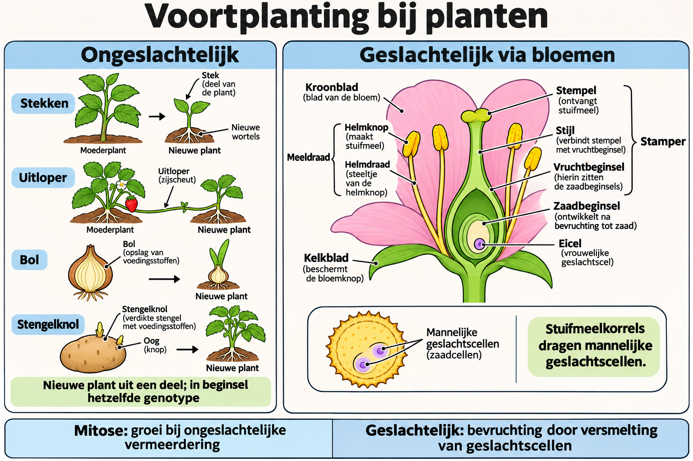

# THEMA 7 Planten

## BASIS 4 Voortplanting

### Samenvatting

Planten kunnen zich ongeslachtelijk en geslachtelijk voortplanten. Bij ongeslachtelijke voortplanting groeit een deel van de plant uit tot een nieuwe plant. Bij geslachtelijke voortplanting zijn twee soorten geslachtscellen nodig. Bloemen zijn nodig voor geslachtelijke voortplanting, omdat daarin de geslachtscellen worden gemaakt.

### Lesdoelen

**Concept:** Geslachtelijke en ongeslachtelijke voortplanting bij planten.

**Vaardigheid:** Vergelijken en functies benoemen.

Je kunt aan het einde van de les voortplantingswijzen bij planten vergelijken en de delen en functies van een bloem beschrijven.

<!--
- Je kunt voorbeelden geven van ongeslachtelijke voortplanting bij planten.
- Je kunt uitleggen wat geslachtelijke voortplanting bij planten is.
- Je kunt de delen van een bloem benoemen.
- Je kunt de functies van bloemonderdelen beschrijven.
-->

### Lesinhoud

Planten kunnen zich op twee manieren voortplanten: ongeslachtelijk en geslachtelijk.

Bij ongeslachtelijke voortplanting groeit een deel van de plant uit tot een nieuwe plant. De nakomelingen hebben dezelfde erfelijke eigenschappen. Daardoor lijken ze erg op de ouderplanten.

Ongeslachtelijke voortplanting kan plaatsvinden door:

- deling
- stekken
- knollen
- bollen
- uitlopers
- wortelstokken

Bij stekken snijd je een deel van een plant af en zet je dat in de grond. Het afgesneden deel heet een stek. Uit de stek kan een nieuwe plant groeien.

Knollen zijn verdikte stengels. Uit een knol kan een nieuwe plant groeien. Die nieuwe plant kan weer knollen maken.

Bollen bestaan uit een bolschijf met rokken. Rokken zijn verdikte bladeren. Tussen de rokken zitten knoppen. De knoppen ontwikkelen zich tot nieuwe bollen. Uit de eindknop ontstaat een plant.

Bij geslachtelijke voortplanting zijn twee soorten geslachtscellen nodig. De celkern bevat de informatie voor erfelijke eigenschappen. Nakomelingen krijgen erfelijke eigenschappen uit de geslachtscellen van de ouderplanten. Daardoor ontstaan nakomelingen met nieuwe erfelijke eigenschappen. Ze kunnen er dus heel anders uitzien dan de ouders.

Bloemen zijn nodig voor geslachtelijke voortplanting. In bloemen worden geslachtscellen gemaakt.

Delen van een bloem zijn:

- kroonblad
- kelkblad
- meeldraad
- stamper
- vruchtbeginsel
- bloemsteel

Kelkbladeren beschermen de bloem als deze nog in de knop zit.

Grote, opvallende kroonbladeren lokken insecten.

Meeldraden zijn de mannelijke voortplantingsorganen van planten. In de helmknoppen ontstaan stuifmeelkorrels. Die kunnen mannelijke geslachtscellen vormen en overbrengen.

Stampers zijn de vrouwelijke voortplantingsorganen van planten. Onderaan de stamper zit het vruchtbeginsel. In het vruchtbeginsel zitten eicellen. Eicellen zijn vrouwelijke geslachtscellen.

### Praktische toepassingen

Als je een plant stekt, gebruik je ongeslachtelijke voortplanting. Uit een afgesneden deel van de plant kan dan een nieuwe plant groeien.

Als je naar een bloem kijkt, kun je de onderdelen herkennen. Kroonbladeren kunnen insecten lokken. Meeldraden maken stuifmeelkorrels. In de stamper zit het vruchtbeginsel met eicellen.

### Begrippen

**Bloemkelk**  
Bestaat uit kelkbladeren.

**Bloemkroon**  
Bestaat uit kroonbladeren.

**Bol**  
Verdikte bladeren met reservestoffen waaruit een nieuwe plant kan ontstaan.

**Kelkblad**  
Bloembladeren die de bloem in de knop beschermen.

**Knol**  
Verdikte stengel met reservestoffen; uit een knol kan een nieuwe plant ontstaan.

**Kroonblad**  
Bloembladeren die om de stamper en meeldraden liggen.

**Meeldraad**  
Mannelijk voortplantingsorgaan van een bloem.

**Stamper**  
Vrouwelijk voortplantingsorgaan van een bloem.

**Stekken**  
Afgesneden deel van een plant laten uitgroeien tot een nieuwe plant.

**Stuifmeelkorrel**  
Korreltje waarin mannelijke geslachtscellen kunnen ontstaan en waarmee ze worden overgebracht.

**Uitloper**  
Bovengrondse stengel waaruit jonge planten ontstaan.

**Vruchtbeginsel**  
Deel van de stamper waarin de eicellen liggen.

**Wortelstok**  
Ondergrondse stengel waaruit jonge planten ontstaan.

### Zelftest

1. Wat is ongeslachtelijke voortplanting bij planten?
2. Waarom lijken nakomelingen bij ongeslachtelijke voortplanting erg op de ouderplanten?
3. Noem drie manieren waarop ongeslachtelijke voortplanting kan plaatsvinden.
4. Wat is stekken?
5. Wat zijn bollen?
6. Wat is nodig bij geslachtelijke voortplanting?
7. Waar worden bij planten geslachtscellen gemaakt?
8. Welke functie hebben kelkbladeren?
9. Welke functie hebben kroonbladeren?
10. Waar zitten de eicellen in een bloem?
11. Wat zijn knollen?
12. Wat is de functie van meeldraden?

#### Antwoorden

1. Een deel van de plant groeit uit tot een nieuwe plant.
2. Ze hebben dezelfde erfelijke eigenschappen.
3. Bijvoorbeeld deling, stekken, knollen, bollen, uitlopers en wortelstokken.
4. Een afgesneden deel van een plant laten uitgroeien tot een nieuwe plant.
5. Verdikte bladeren met reservestoffen waaruit een nieuwe plant kan ontstaan.
6. Twee soorten geslachtscellen.
7. In de bloemen.
8. Ze beschermen de bloem als deze nog in de knop zit.
9. Grote, opvallende kroonbladeren lokken insecten.
10. In het vruchtbeginsel.
11. Knollen zijn verdikte stengels waaruit een nieuwe plant kan groeien.
12. Meeldraden zijn de mannelijke voortplantingsorganen van planten.

### Afbeelding: voortplanting bij planten

#### Tekstbeschrijving van de afbeelding

- **Ongeslachtelijk:** uit een deel van een plant kan een nieuwe plant ontstaan, bijvoorbeeld via stekken, uitlopers, bollen of stengelknollen. Groei gebeurt door mitose. De nieuwe plant heeft in beginsel hetzelfde genotype, afgezien van mogelijke mutaties.
- **Bloem:** kroonbladeren kunnen insecten aantrekken en kelkbladeren beschermen de knop. Een meeldraad bestaat uit helmdraad en helmknop. De stamper bestaat uit stempel, stijl en vruchtbeginsel.
- **Geslachtscellen:** stuifmeelkorrels dragen mannelijke geslachtscellen; een stuifmeelkorrel is niet zelf één geslachtscel. In het vruchtbeginsel liggen zaadbeginsels met elk een eicel.
- **Geslachtelijk:** bij bevruchting versmelten geslachtscellen. Meiose is een ander proces, betrokken bij de vorming van haploïde voortplantingscellen. Geslachtelijke voortplanting kan nieuwe combinaties van erfelijke informatie opleveren.

Pijlen en opschriften geven de betekenis aan; kleur onderscheiden is niet nodig.
