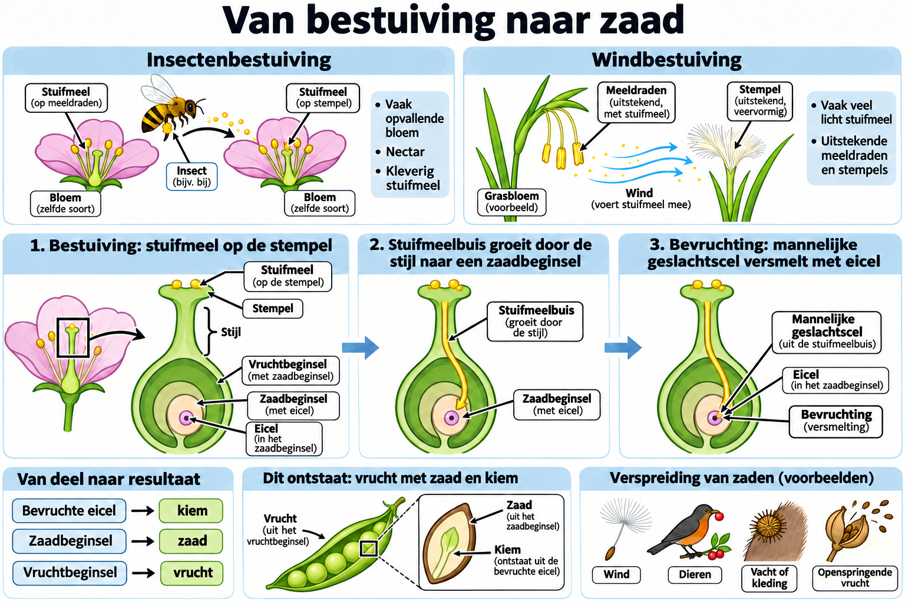

# THEMA 7 Planten

## BASIS 5 Bestuiving en bevruchting

### Samenvatting

Bij bestuiving komen stuifmeelkorrels op de stamper van een bloem van dezelfde soort. Planten kunnen worden bestoven door insecten of door de wind. Na bestuiving kan een stuifmeelkorrel een stuifmeelbuis maken. Bij bevruchting versmelt de kern van de stuifmeelkorrel met de kern van de eicel. Daarna kunnen zaden en vruchten ontstaan.

### Lesdoelen

**Concept:** Bestuiving, bevruchting en zaadvorming.

**Vaardigheid:** Een proces beschrijven en kenmerken vergelijken.

Je kunt aan het einde van de les bestuiving en bevruchting uitleggen en kenmerken van insectenbloemen en windbloemen verbinden met zaad- en vruchtvorming.

<!--
- Je kunt uitleggen wat bestuiving is.
- Je kunt kenmerken noemen van insectenbloemen.
- Je kunt kenmerken noemen van windbloemen.
- Je kunt beschrijven hoe bevruchting bij zaadplanten verloopt.
- Je kunt uitleggen hoe zaden en vruchten ontstaan.
-->

### Lesinhoud

Bestuiving betekent dat stuifmeelkorrels op de stamper van een bloem van dezelfde soort komen. De stuifmeelkorrels moeten boven op de stamper terechtkomen.

Planten kunnen worden bestoven door insecten en door de wind.

Insectenbloemen hebben meestal grote bloemen. De kroonbladeren zijn meestal opvallend gekleurd. De bloemen geuren en hebben vaak nectar. De stuifmeelkorrels zijn ruw en kleverig. De meeldraden maken weinig stuifmeelkorrels. De meeldraden en stampers zitten binnen in de bloemen. De stamper is meestal klein.

Windbloemen hebben meestal kleine bloemen. De kroonbladeren zijn meestal groen. De bloemen geuren niet en hebben geen nectar. De stuifmeelkorrels zijn licht en glad. De meeldraden maken heel veel stuifmeelkorrels. De meeldraden en stampers steken buiten de bloemen uit. De stamper is groot en veervormig.

Na bestuiving kan een stuifmeelkorrel een stuifmeelbuis maken. De stuifmeelbuis groeit naar de eicel in het vruchtbeginsel. Er kunnen meerdere stuifmeelbuizen tegelijk naar verschillende eicellen in het vruchtbeginsel groeien.

Bij bevruchting versmelt de kern van een mannelijke geslachtscel met de kern van de eicel. De mannelijke geslachtscel wordt via de stuifmeelbuis aangevoerd. Door bevruchting ontstaat een bevruchte eicel.

Na bevruchting ontwikkelt een zaadbeginsel zich tot een zaad. In een vruchtbeginsel kunnen meerdere zaden ontstaan. Een bevruchte eicel groeit uit tot de kiem binnen het zaad.

Vruchten ontstaan uit het vruchtbeginsel. Daarbij vallen kroonbladeren af. Kelkbladeren en meeldraden verschrompelen. De wand van het vruchtbeginsel wordt groter en dikker. Het vruchtbeginsel groeit uit tot een vrucht.

### Praktische toepassingen

Als je bloemen bekijkt, kun je soms herkennen hoe ze bestoven worden. Grote, opvallende en geurende bloemen met nectar passen bij insectenbloemen. Kleine, groene bloemen zonder geur en nectar passen bij windbloemen.

Bij vruchten kun je bedenken dat ze uit het vruchtbeginsel ontstaan. Zaden ontstaan uit zaadbeginsels; de bevruchte eicel vormt de kiem.

### Begrippen

**Bestuiving**  
Stuifmeelkorrels van een bloem komen op de stamper van een bloem van dezelfde soort.

**Insectenbloem**  
Bloem waarvan de stuifmeelkorrels verspreid worden door insecten.

**Kiem**  
Deel van het zaad dat kan uitgroeien tot een nieuwe plant.

**Windbloem**  
Bloem waarvan de stuifmeelkorrels verspreid worden door de wind.

**Zaad**  
Ontstaat uit een zaadbeginsel en bevat een kiem die tot een nieuwe plant kan uitgroeien.

### Zelftest

1. Wat betekent bestuiving?
2. Waar moeten stuifmeelkorrels bij bestuiving terechtkomen?
3. Noem drie kenmerken van insectenbloemen.
4. Noem drie kenmerken van windbloemen.
5. Wat maakt een stuifmeelkorrel na bestuiving?
6. Waar groeit de stuifmeelbuis naartoe?
7. Wat versmelt er bij bevruchting?
8. Wanneer ontstaan zaden?
9. Waaruit groeit een bevruchte eicel uit?
10. Welke veranderingen gebeuren er als het vruchtbeginsel uitgroeit tot een vrucht?

#### Antwoorden

1. Stuifmeelkorrels komen op de stamper van een bloem van dezelfde soort.
2. Boven op de stamper.
3. Bijvoorbeeld: meestal groot, opvallend gekleurde kroonbladeren, geur, vaak nectar, ruwe en kleverige stuifmeelkorrels.
4. Bijvoorbeeld: meestal klein, groene kroonbladeren, geen geur, geen nectar, lichte en gladde stuifmeelkorrels, veel stuifmeelkorrels.
5. Een stuifmeelbuis.
6. Naar de eicel in het vruchtbeginsel.
7. De kern van een mannelijke geslachtscel versmelt met de kern van de eicel.
8. Na bevruchting ontwikkelen zaadbeginsels zich tot zaden.
9. Tot een kiem.
10. Kroonbladeren vallen af, kelkbladeren en meeldraden verschrompelen, de wand van het vruchtbeginsel wordt groter en dikker, en het vruchtbeginsel groeit uit tot een vrucht.

### Afbeelding: bestuiving, bevruchting en zaadvorming

#### Tekstbeschrijving van de afbeelding

- **Bestuiving:** stuifmeel komt op de stempel van een bloem van dezelfde soort. Bij insectenbestuiving helpen vaak opvallende kroonbladeren, nectar en kleverig stuifmeel. Windbloemen hebben vaak veel licht stuifmeel en uitstekende helmknoppen en stempels.
- **Van stuifmeel naar eicel:** uit een geschikte stuifmeelkorrel groeit een stuifmeelbuis door de stijl naar een zaadbeginsel in het vruchtbeginsel. Een mannelijke geslachtscel bereikt via die buis de eicel.
- **Bevruchting en vorming:** uit de bevruchte eicel ontstaat de kiem. Het zaadbeginsel ontwikkelt zich tot zaad en het vruchtbeginsel tot vrucht. Een zaad is dus meer dan alleen de bevruchte eicel.
- **Verspreiding:** vruchten en zaden kunnen worden verplaatst door wind, dieren, vacht of kleding, of door een openspringende vrucht. De afbeelding houdt verspreiding na zaadvorming apart van bestuiving vóór bevruchting.

Pijlen en opschriften geven de betekenis aan; kleur onderscheiden is niet nodig.
