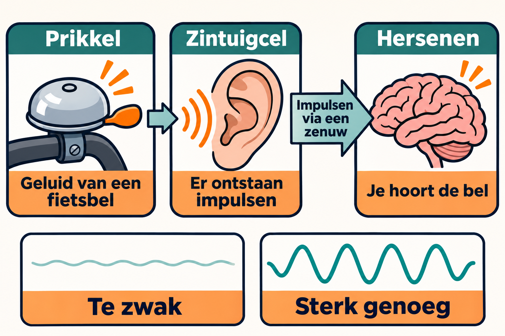

# Thema 9 Zintuigen - Basis

## Basisstof 1 Het zintuigenstelsel

### Samenvatting

Met je zintuigen merk je veranderingen binnen en buiten je lichaam op. Zintuigcellen kunnen een prikkel omzetten in impulsen. Je grote hersenen verwerken die impulsen, waardoor je iets bewust waarneemt.

### Lesdoelen

**Concept:** Zintuig, prikkel, impuls, waarnemen en zintuigenstelsel.

**Vaardigheid:** De weg van een prikkel naar een bewuste waarneming beschrijven.

Je kunt uitleggen hoe zintuigen en hersenen samenwerken wanneer je iets waarneemt.

### Lesinhoud

#### Prikkels opvangen

Een **prikkel** is een verandering die een zintuig kan opmerken. Licht, geluid en druk op je huid zijn voorbeelden. Je kunt ook iets binnen je lichaam opmerken, zoals het gevoel van een volle blaas. Alle zintuigen van je lichaam vormen samen het **zintuigenstelsel**.

#### Van prikkel naar waarneming

Een **zintuig** bevat speciale **zintuigcellen**. Wanneer die cellen reageren op een prikkel, kunnen er **impulsen** ontstaan. Impulsen zijn elektrische signalen. Zenuwen geven deze signalen door aan je hersenen. Als je grote hersenen de informatie bewust verwerken, neem je de prikkel waar.

Prikkel → zintuigcellen → impulsen via zenuwen → grote hersenen → bewuste waarneming

### Belangrijke begrippen

- **Zintuig** — Orgaan of deel van een orgaan dat prikkels opvangt en kan omzetten in impulsen.
- **Prikkel** — Verandering waarop een zintuig kan reageren.
- **Impuls** — Elektrisch signaal dat informatie doorgeeft.
- **Waarnemen** — Iets bewust opmerken.
- **Zintuigenstelsel** — Alle zintuigen van je lichaam samen.

### Praktische toepassingen

Iemand belt aan. Geluid bereikt je oren. Zintuigcellen in je oren reageren en sturen via zenuwen impulsen naar je hersenen. Daar verwerk je de informatie en herken je de deurbel.

### Zelftest

1. Geef een voorbeeld van een prikkel van buiten je lichaam.
2. Wat bedoelen we met het zintuigenstelsel?
3. Wat kan er in zintuigcellen gebeuren als ze een prikkel opvangen?
4. Hoe komen impulsen van zintuigcellen bij de hersenen?
5. Wanneer word je je bewust van een prikkel?
6. Wat is bij een deurbel de prikkel en wat is de waarneming?

#### Antwoorden

1. Bijvoorbeeld het geluid van een deurbel.
2. Alle zintuigen van je lichaam samen.
3. Er kunnen elektrische signalen ontstaan. Die heten impulsen.
4. Zenuwen geleiden de impulsen naar de hersenen.
5. Als je grote hersenen de informatie bewust verwerken.
6. Het geluid is de prikkel. Je merkt bewust dat je de deurbel hoort.

### Referentie

[Samenvatting Thema 9 Zintuigen](../samenvattingen/T9_Zintuigen.pdf), basis 1, gedrukte pagina 255.

### Afbeelding: van prikkel naar waarneming

#### Tekstbeschrijving van de afbeelding

Drie stappen tonen wat er gebeurt als je een fietsbel hoort. Het geluid van de bel is de prikkel. In de zintuigcellen van het oor ontstaan impulsen. Een zenuw geleidt die impulsen naar de hersenen. Daar verwerk je ze en hoor je de bel. Onderaan staat een voorbeeld van een geluid dat voor jou te zwak is om te horen en een geluid dat sterk genoeg is.
