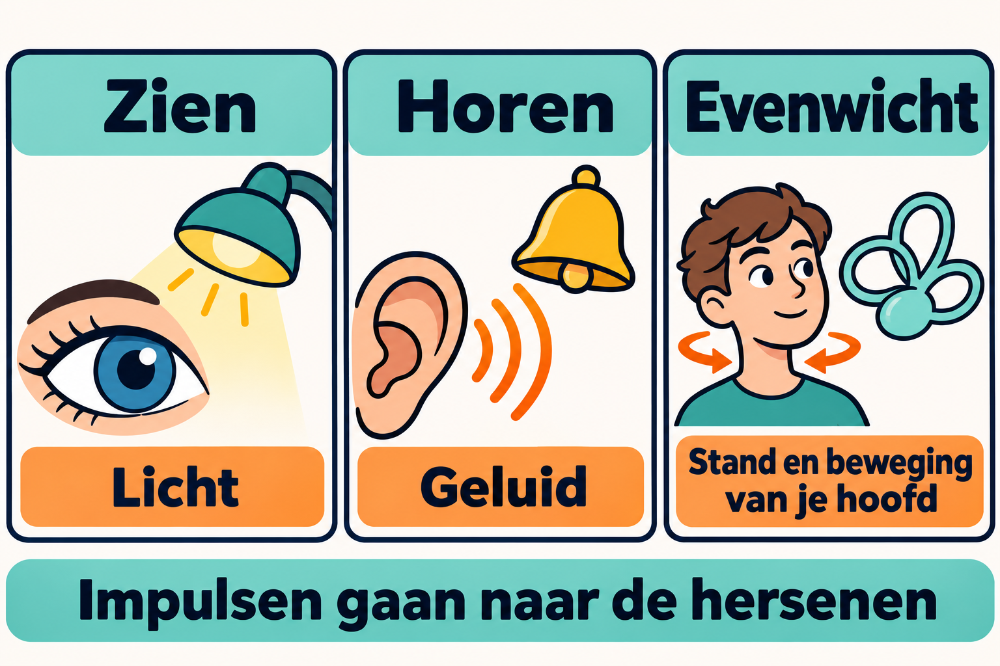

# Thema 9 Zintuigen - Basis

## Basisstof 2 Zien, horen en je evenwicht bewaren

### Samenvatting

Het gezichtszintuig reageert op licht en het gehoorzintuig op geluid. Je evenwichtszintuig merkt de stand en beweging van je hoofd op. Via zenuwen komt die informatie als impulsen bij de hersenen.

### Lesdoelen

**Concept:** Gezichtszintuig, gehoorzintuig en evenwichtszintuig.

**Vaardigheid:** Elk zintuig koppelen aan zijn plaats in het lichaam en zijn prikkel.

Je kunt aanwijzen waar je zintuigen voor zien, horen en evenwicht liggen en uitleggen waarop ze reageren.

### Lesinhoud

#### Zien

Het **gezichtszintuig** ligt in het **netvlies**, achter in de oogbol. Zintuigcellen in het netvlies reageren op licht. Bij het zien van een verkeerslicht bereikt licht van de lamp je oog. Via de oogzenuw gaan impulsen naar je hersenen.

#### Horen

Het **gehoorzintuig** ligt in het **slakkenhuis**, diep in het oor. Geluid bestaat uit trillingen die zich door de lucht verplaatsen. Wanneer de trillingen het slakkenhuis bereiken, reageren de gehoorzintuigcellen. Via de gehoorzenuw gaan impulsen naar de hersenen.

#### Je evenwicht bewaren

Het **evenwichtszintuig** ligt in het binnenoor naast het slakkenhuis. Het merkt bewegingen van je hoofd op. Het neemt ook waar hoe je hoofd staat ten opzichte van de zwaartekracht. Je hersenen gebruiken deze informatie samen met signalen van je ogen en spieren om je evenwicht te bewaren.

### Belangrijke begrippen

- **Gezichtszintuig** — Zintuig in het netvlies dat op licht reageert.
- **Gehoorzintuig** — Zintuig in het slakkenhuis dat reageert op geluidstrillingen.
- **Evenwichtszintuig** — Zintuig in het binnenoor dat de stand en beweging van het hoofd registreert.

### Praktische toepassingen

Als je je hoofd naar je schouder kantelt, ontvangt je brein informatie over de nieuwe stand. Je evenwichtszintuig geeft die informatie ook door wanneer je je ogen sluit.

### Zelftest

1. Waar in het oog ligt het gezichtszintuig?
2. Op welke prikkel reageert het gezichtszintuig?
3. Wat verplaatst zich door de lucht wanneer iemand voor je klapt?
4. Waar ligt het gehoorzintuig?
5. In welk deel van het oor ligt het evenwichtszintuig?
6. Hoe weet je lichaam met gesloten ogen dat je je hoofd schuin houdt?

#### Antwoorden

1. In het netvlies, achter in de oogbol.
2. Op licht.
3. Geluidstrillingen.
4. In het slakkenhuis, diep in het oor.
5. In het binnenoor, naast het slakkenhuis.
6. Het evenwichtszintuig merkt de stand van je hoofd ten opzichte van de zwaartekracht op en geeft daarover impulsen door aan de hersenen.

### Referentie

[Samenvatting Thema 9 Zintuigen](../samenvattingen/T9_Zintuigen.pdf), basis 2, gedrukte pagina 255.

### Afbeelding: zien, horen en evenwicht

#### Tekstbeschrijving van de afbeelding

Een lamp en een oog staan voor zien. Licht is de prikkel. Een bel en een oor staan voor horen. Geluid is de prikkel. Een draaiend hoofd en een symbool voor het binnenoor staan voor evenwicht. Het evenwichtszintuig geeft informatie over de stand en beweging van je hoofd. Impulsen van alle drie de zintuigen gaan naar de hersenen.
