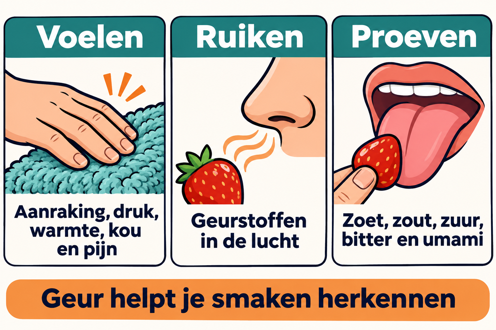

# Thema 9 Zintuigen - Basis

## Basisstof 3 Voelen, ruiken en proeven

### Samenvatting

Zintuigen in je huid laten je aanraking, druk, temperatuur en pijn opmerken. In je neus herken je geurstoffen. Smaakknopjes op je tong nemen vijf basissmaken waar. Geur helpt je om eten en drinken te herkennen.

### Lesdoelen

**Concept:** Drukzintuig, tastzintuig, warmtezintuig, koudezintuig, pijnpunt, reukzintuig en smaakzintuig.

**Vaardigheid:** Per zintuig aangeven waar het ligt en op welke prikkel het reageert.

Je kunt uitleggen wat je huid, neus en tong waarnemen en waarom geur en smaak samenwerken.

### Lesinhoud

#### Voelen met je huid

In de **lederhuid**, onder de opperhuid, liggen zintuigen waarmee je kunt voelen.

| Zintuig | Wat merk je? | Voorbeeld |
|---|---|---|
| Tastzintuig | Lichte aanraking | Een veertje strijkt langs je arm |
| Drukzintuig | Stevigere druk | Een tasband drukt op je schouder |
| Warmtezintuig | Opwarming van je huid | Je houdt een warme mok vast |
| Koudezintuig | Afkoeling van je huid | Je raakt een koud raam aan |
| Pijnpunt | Een mogelijk schadelijke prikkel | Je prikt je aan een doorn |

#### Ruiken met je neus

Boven in de neusholte ligt het **reukzintuig** in het slijmvlies. Geurstoffen komen met de lucht naar binnen. Als reukzintuigcellen erop reageren, gaan impulsen naar je hersenen. Zo herken je bijvoorbeeld de geur van vers brood.

#### Proeven met je tong

De kleine bobbeltjes op je tong heten **smaakpapillen**. In en langs veel van deze papillen liggen **smaakknopjes** met smaakzintuigcellen. Die reageren op stoffen die in speeksel oplossen. Je onderscheidt vijf basissmaken. Dat zijn **zoet, zout, zuur, bitter en umami**. Umami is een hartige smaak, bijvoorbeeld in bouillon. Tijdens het eten komen ook geurstoffen bij het reukzintuig. De combinatie van geur en smaak helpt je herkennen wat je eet.

### Belangrijke begrippen

- **Lederhuid** — Laag van de huid onder de opperhuid.
- **Pijnpunt** — Zenuwuiteinde dat kan reageren op een mogelijk schadelijke prikkel.
- **Reukzintuig** — Zintuig boven in de neusholte dat reageert op geurstoffen.
- **Smaakknopje** — Groepje cellen dat prikkels voor smaak kan waarnemen.

### Praktische toepassingen

Als je verkouden bent, kan een aardbei nog zoet smaken. De typische aardbeigeur merk je vaak minder goed. Daardoor is het moeilijker om al proevend een aardbei te herkennen.

### Zelftest

1. In welke huidlaag liggen de zintuigen waarmee je voelt?
2. Welk zintuig reageert op de druk van een tasband?
3. Wat neem je waar als een ijsklontje je huid afkoelt en welke zintuigen reageren?
4. Waar ligt het reukzintuig en wat is de prikkel?
5. Waar zitten de smaakknopjes en wat zijn de vijf basissmaken?
6. Waarom herken je bij een verstopte neus de smaak van fruit vaak minder goed?

#### Antwoorden

1. In de lederhuid.
2. Het drukzintuig.
3. Je voelt kou. De koudezintuigen reageren op de afkoeling van je huid.
4. Boven in de neusholte, in het slijmvlies. De prikkel is een geurstof in de lucht.
5. Ze zitten in en langs smaakpapillen op de tong. De basissmaken zijn zoet, zout, zuur, bitter en umami.
6. Er bereiken minder geurstoffen het reukzintuig. Daardoor herkennen je hersenen de geur van het fruit minder goed.

### Referentie

[Samenvatting Thema 9 Zintuigen](../samenvattingen/T9_Zintuigen.pdf), basis 3, gedrukte pagina’s 255–256.

### Afbeelding: voelen, ruiken en proeven

#### Tekstbeschrijving van de afbeelding

Links raakt een hand een oppervlak aan. De huid neemt aanraking, druk, warmte, kou en pijn waar. In het midden bereikt de geur van een aardbei een neus. Rechts staat een tong bij een aardbei. De tong neemt zoet, zout, zuur, bitter en umami waar. Geur helpt je herkennen wat je eet.
