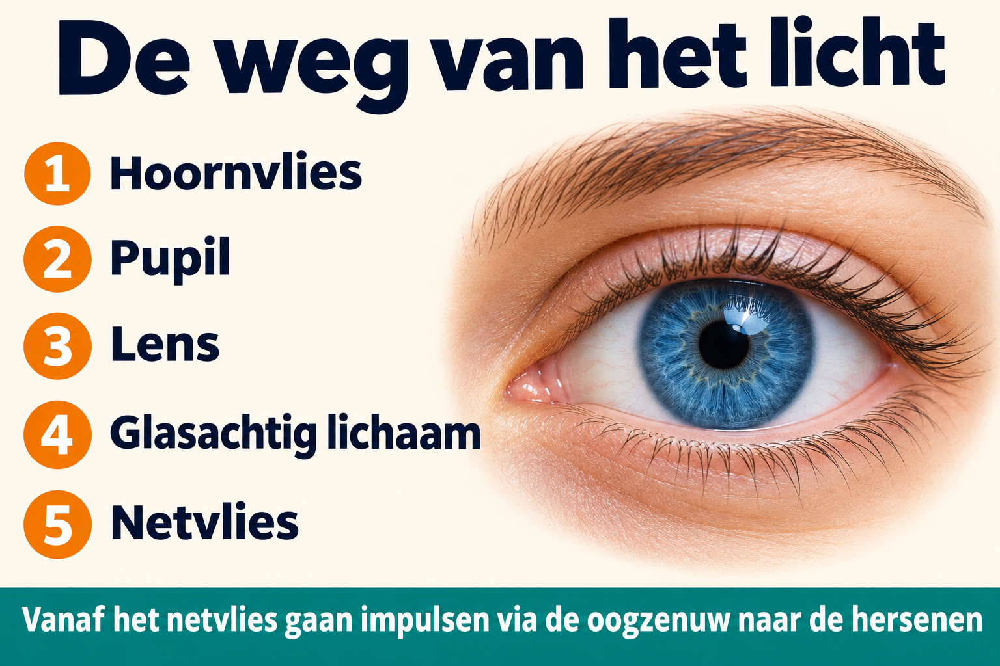

# Thema 9 Zintuigen - Basis

## Basisstof 4 De ogen

### Samenvatting

Licht gaat via het hoornvlies, de pupil, de lens en het glasachtig lichaam naar het netvlies. Zintuigcellen in het netvlies zetten de lichtprikkel om in impulsen. De oogzenuw brengt die impulsen naar de hersenen.

### Lesdoelen

**Concept:** Oogbescherming, bouw van het oog, lichtweg en scherpstellen.

**Vaardigheid:** Oogonderdelen herkennen en hun functies aan de lichtweg koppelen.

Je kunt uitleggen hoe je ogen beschermd worden, welke weg licht aflegt en hoe je dichtbij en veraf scherp ziet.

### Lesinhoud

#### Bescherming van je ogen

| Onderdeel | Functie |
|---|---|
| Wenkbrauwen | Laten zweet en regen langs je ogen lopen |
| Wimpers | Houden vuil en een deel van het felle licht tegen |
| Traanklieren | Maken traanvocht dat je ogen vochtig houdt en vuil wegspoelt |
| Traanbuizen | Voeren traanvocht af naar de neusholte |
| Hard oogvlies | Beschermt het binnenste van het oog met een stevige buitenlaag |

#### De delen aan de buitenkant

Het zichtbare witte deel van je oog is het **harde oogvlies**. Het doorzichtige **hoornvlies** vormt de voorkant van deze buitenlaag. Licht kan erdoorheen. Daarachter ligt de **iris**, de gekleurde ring die de grootte van de **pupil** regelt. De pupil is een opening. Bij fel licht is die opening kleiner, zodat er minder licht binnenkomt.

#### De delen aan de binnenkant

| Onderdeel | Functie |
|---|---|
| Lens | Bundelt licht en helpt om scherp te stellen |
| Glasachtig lichaam | Doorzichtige gel die de oogbol in vorm houdt en licht doorlaat |
| Netvlies | Bevat zintuigcellen die licht omzetten in impulsen |
| Vaatvlies | Bevat bloedvaten die voedingsstoffen aanvoeren en afvalstoffen afvoeren |
| Oogzenuw | Geleidt impulsen van het netvlies naar de hersenen |

#### Van licht naar een beeld

Licht volgt deze route door het oog.

Hoornvlies → pupil → lens → glasachtig lichaam → netvlies

Het beeld op het netvlies is kleiner en staat ondersteboven. Je hersenen verwerken de impulsen van beide ogen, waardoor je de wereld om je heen normaal waarneemt. Voor een voorwerp dichtbij wordt de lens boller. Voor een voorwerp veraf wordt de lens platter. **Oogspieren** aan de buitenkant draaien de oogbol naar het voorwerp waarnaar je kijkt.

### Belangrijke begrippen

- **Hoornvlies** — Doorzichtige beschermlaag aan de voorkant van het oog.
- **Iris** — Gekleurde ring die bepaalt hoe groot de pupil is.
- **Pupil** — Opening in de iris waardoor licht naar binnen komt.
- **Netvlies** — Laag achter in het oog met zintuigcellen die op licht reageren.
- **Oogzenuw** — Zenuw die impulsen van het netvlies naar de hersenen geleidt.

### Praktische toepassingen

Je kijkt van een blad op je tafel naar een bord aan de muur. De lens wordt platter. Wanneer je weer op het blad kijkt, wordt de lens boller.

### Zelftest

1. Wat doen wenkbrauwen en wimpers voor je ogen?
2. Waar ontstaat traanvocht en waarheen wordt het afgevoerd?
3. Wat is het verschil tussen de iris en de pupil?
4. Noem de vijf stappen op de weg van het licht naar het netvlies.
5. Wat gebeurt er in het netvlies en hoe bereikt de informatie de hersenen?
6. Welke vorm heeft de lens als je dichtbij scherp ziet?
7. Welk deel zorgt met zijn bloedvaten voor de aanvoer van voedingsstoffen?

#### Antwoorden

1. Wenkbrauwen leiden vocht langs de ogen. Wimpers helpen vuil en fel licht tegen te houden.
2. Traanklieren maken traanvocht. Traanbuizen voeren het af naar de neusholte.
3. De iris is de gekleurde ring. De pupil is de opening in die ring.
4. Hoornvlies → pupil → lens → glasachtig lichaam → netvlies.
5. Zintuigcellen reageren op licht en vormen impulsen. De oogzenuw geleidt die naar de hersenen.
6. De lens is boller dan wanneer je ver weg kijkt.
7. Het vaatvlies.

### Referentie

[Samenvatting Thema 9 Zintuigen](../samenvattingen/T9_Zintuigen.pdf), basis 4, gedrukte pagina’s 256–257.

### Afbeelding: de weg van het licht door het oog

#### Tekstbeschrijving van de afbeelding

Het schema volgt het licht vanaf de voorkant van het oog. Het gaat eerst door het hoornvlies, dan door de pupil en de lens en vervolgens door het glasachtig lichaam. Achter in het oog bereikt het licht het netvlies. Vanaf daar gaan impulsen via de oogzenuw naar de hersenen.
