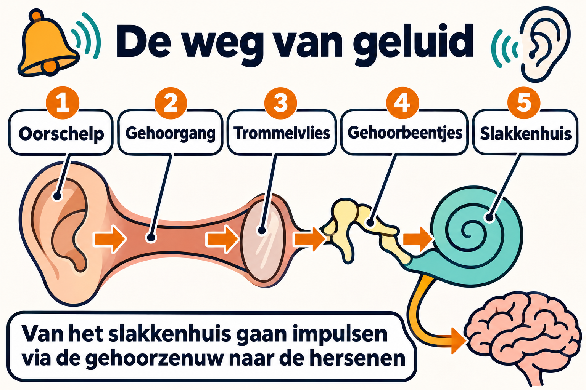

# Thema 9 Zintuigen - Basis

## Basisstof 5 De oren

### Samenvatting

Het oor vangt geluidstrillingen op. Via het trommelvlies en de gehoorbeentjes komen die trillingen bij het slakkenhuis. De zintuigcellen daar zorgen dat impulsen via de gehoorzenuw naar de hersenen gaan. In het binnenoor ligt ook het evenwichtsorgaan.

### Lesdoelen

**Concept:** Bouw van het oor, geluidstrilling, gehoorzenuw en evenwichtsorgaan.

**Vaardigheid:** De onderdelen van het oor benoemen en de routes van trillingen en impulsen volgen.

Je kunt uitleggen hoe je geluid hoort, waar je evenwichtsorgaan ligt en hoe hard geluid gehoorschade kan veroorzaken.

### Lesinhoud

#### Van geluid naar trillingen in het slakkenhuis

Geluid bestaat uit trillingen die zich door de lucht verplaatsen. De **oorschelp** vangt die trillingen op. Via de **gehoorgang** bereiken ze het **trommelvlies**, dat gaat meetrillen. Achter het trommelvlies ligt de **trommelholte**, de luchtruimte van het middenoor met de **gehoorbeentjes**. Deze kleine botjes geven de trilling door aan het slakkenhuis.

Oorschelp → gehoorgang → trommelvlies → gehoorbeentjes → slakkenhuis

#### Van trillingen naar impulsen

Door de trilling komt vloeistof in het **slakkenhuis** in beweging. Daardoor reageren gehoorzintuigcellen en ontstaan er impulsen. De **gehoorzenuw** geleidt de impulsen naar je hersenen. Daar neem je het geluid bewust waar.

#### Luchtdruk en gehoorbescherming

De **buis van Eustachius** verbindt de trommelholte met de keelholte. Hij gaat onder andere open als je slikt of gaapt. Zo kan de luchtdruk aan beide kanten van het trommelvlies gelijk worden.

Door hard geluid kunnen zintuigcellen in het slakkenhuis blijvend beschadigd raken. Een heel harde knal kan ook het trommelvlies beschadigen. Je verkleint de kans op schade door het volume lager te zetten, afstand te houden van de geluidsbron of gehoorbescherming te dragen.

#### Het evenwichtsorgaan

Het **evenwichtsorgaan** ligt naast het slakkenhuis in het binnenoor. Het registreert hoe je hoofd beweegt en hoe het staat ten opzichte van de zwaartekracht. De hersenen gebruiken de impulsen van dit orgaan om je houding en evenwicht te regelen.

### Belangrijke begrippen

- **Trommelvlies** — Dun vlies dat meetrilt met geluid.
- **Gehoorbeentjes** — Kleine botjes die trillingen doorgeven aan het slakkenhuis.
- **Slakkenhuis** — Deel van het binnenoor met gehoorzintuigcellen.
- **Gehoorzenuw** — Zenuw die impulsen van het slakkenhuis naar de hersenen geleidt.
- **Buis van Eustachius** — Verbinding die helpt om de luchtdruk aan beide kanten van het trommelvlies gelijk te maken.
- **Evenwichtsorgaan** — Deel van het binnenoor dat bewegingen en de stand van je hoofd registreert.

### Praktische toepassingen

In een vliegtuig verandert de druk buiten het oor. Je oren kunnen daardoor dicht aanvoelen. Slikken kan helpen doordat de buis van Eustachius even opengaat en de druk gelijker wordt.

### Zelftest

1. Welke delen vangen geluid op en brengen het naar het trommelvlies?
2. Waar liggen de gehoorbeentjes en wat doen ze?
3. In welk deel van het oor ontstaan impulsen door geluidstrillingen?
4. Wat vervoert de gehoorzenuw naar de hersenen?
5. Wat gebeurt er met het drukverschil als de buis van Eustachius opengaat?
6. Welke twee onderdelen kunnen door zeer hard geluid beschadigd raken?
7. Welke informatie geeft het evenwichtsorgaan door?

#### Antwoorden

1. De oorschelp vangt het op. De gehoorgang brengt de trillingen naar het trommelvlies.
2. Ze liggen in de trommelholte en geven trillingen van het trommelvlies door aan het slakkenhuis.
3. In het slakkenhuis.
4. Elektrische signalen. Die heten impulsen.
5. Het drukverschil kan kleiner worden of verdwijnen.
6. De zintuigcellen in het slakkenhuis en het trommelvlies.
7. Informatie over de stand en beweging van je hoofd.

### Referentie

[Samenvatting Thema 9 Zintuigen](../samenvattingen/T9_Zintuigen.pdf), basis 5, gedrukte pagina 258.

### Afbeelding: de weg van geluid door het oor

#### Tekstbeschrijving van de afbeelding

De vijf genummerde onderdelen volgen de weg van de geluidstrilling. De oorschelp vangt het geluid op. Via de gehoorgang bereikt de trilling het trommelvlies. De gehoorbeentjes geven de trilling door aan het slakkenhuis. Vanaf het slakkenhuis gaan impulsen via de gehoorzenuw naar de hersenen.
