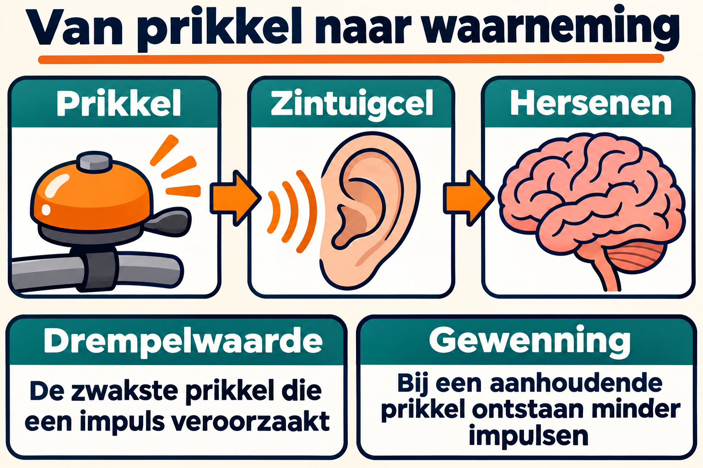

# Thema 11 Zintuigen - GT

## Basisstof 1 Het zintuigenstelsel

### Samenvatting

Zintuigcellen reageren op prikkels. Voor elke zintuigcel is er een type prikkel waarvoor die cel extra gevoelig is. De sterkte van de prikkel, gewenning en je aandacht bepalen mede wat je opmerkt.

### Lesdoelen

**Concept:** Zintuigcel, impuls, adequate prikkel, drempelwaarde en gewenning.

**Vaardigheid:** Verklaren waarom dezelfde prikkel soms wel en soms nauwelijks wordt opgemerkt.

Je kunt uitleggen hoe een prikkel tot een waarneming leidt en welke factoren daarop invloed hebben.

### Lesinhoud

#### Van prikkel naar waarneming

Een **zintuig** is een orgaan of deel van een orgaan met zintuigcellen. Zodra een prikkel sterk genoeg is, kunnen er **impulsen** ontstaan. Zenuwen geleiden die elektrische signalen naar de hersenen. Door de verwerking in de hersenen kun je de prikkel bewust waarnemen.

#### Drempelwaarde en adequate prikkel

De **drempelwaarde** is de kleinste prikkelsterkte die een impuls kan veroorzaken. De **adequate prikkel** is het type prikkel waarvoor een zintuigcel speciaal gevoelig is. Voor dat type prikkel is de drempelwaarde laag. Zintuigcellen in het netvlies reageren bijvoorbeeld al op zwak licht.

#### Gewenning, aandacht en motivatie

Bij **gewenning** neemt de reactie op een aanhoudende prikkel af. Zintuigcellen kunnen daarbij minder impulsen afgeven. Ook de hersenen kunnen minder aandacht geven aan informatie die steeds terugkomt. **Motivatie** kan beïnvloeden waarop je let. Daardoor merk je een zwakke prikkel eerder op als je er gericht naar luistert of kijkt.

### Belangrijke begrippen

- **Adequate prikkel** — Type prikkel waarvoor een zintuigcel speciaal gevoelig is.
- **Drempelwaarde** — Kleinste prikkelsterkte waarbij een impuls ontstaat.
- **Gewenning** — Afnemende reactie op een prikkel die langere tijd aanhoudt of terugkomt.
- **Motivatie** — Wat je ertoe brengt om ergens gericht aandacht aan te geven.

### Praktische toepassingen

Bij het opzetten merk je de druk van een koptelefoon. Na een tijdje valt die druk minder op, ook als de koptelefoon nog hetzelfde zit. Als je aandacht weer naar de koptelefoon gaat, merk je de druk vaak opnieuw op.

### Zelftest

1. Wat is het verschil tussen een prikkel en een impuls?
2. Welke adequate prikkel hebben zintuigcellen in het netvlies?
3. Wat gebeurt er als een geluid onder je gehoordrempel blijft?
4. Waarom merk je de druk van een koptelefoon na een tijdje minder op?
5. Twee leerlingen zitten op dezelfde afstand van een zacht geluid. Eén leerling moet erop letten en merkt het eerder op. Hoe kan dat?
6. Zet in volgorde: bewuste waarneming, prikkel, verwerking in de hersenen en impulsen.

#### Antwoorden

1. Een prikkel is een verandering waarop een zintuigcel kan reageren. Een impuls is een elektrisch signaal dat informatie doorgeeft.
2. Licht.
3. Het geluid is te zwak om een reactie te veroorzaken waarmee je het kunt horen.
4. Je went aan de aanhoudende druk. Het zintuig kan minder impulsen afgeven en je hersenen besteden minder aandacht aan het signaal.
5. Door motivatie let die leerling gericht op het geluid. De hersenen geven het signaal daardoor meer aandacht.
6. Prikkel → impulsen → verwerking in de hersenen → bewuste waarneming.

### Referentie

[Samenvatting Thema 11 Zintuigen](../samenvattingen/T4_T11_Zintuigen_-_Samenvatting.pdf), basis 1, gedrukte pagina 240.

### Afbeelding: van prikkel naar waarneming

#### Tekstbeschrijving van de afbeelding

De fietsbel levert een geluidsprikkel. Zintuigcellen in het oor kunnen impulsen vormen, die naar de hersenen gaan. De drempelwaarde is de zwakste prikkel die een impuls veroorzaakt. Bij gewenning kan een aanhoudende prikkel steeds minder impulsen opleveren.
