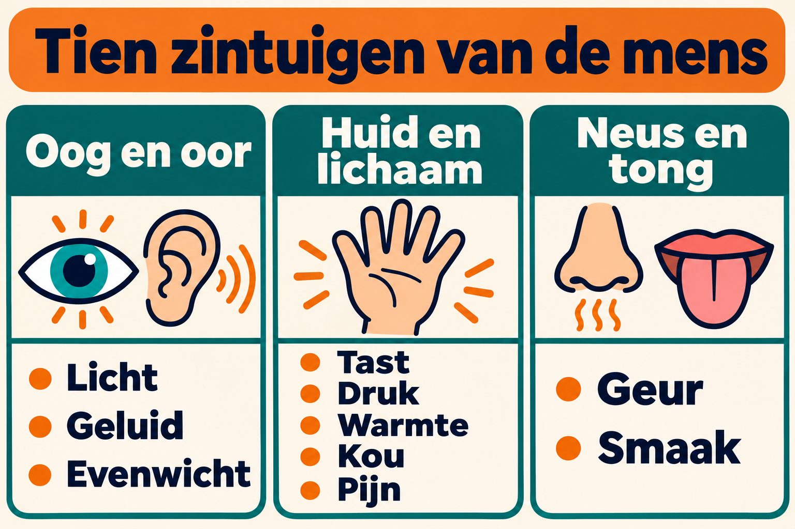

# Thema 11 Zintuigen - GT

## Basisstof 2 Tien zintuigen van de mens

### Samenvatting

Elk zintuig reageert op een eigen soort prikkel. Zintuigen in je ogen en oren nemen licht, geluid en de stand of beweging van je hoofd waar. Andere zintuigen nemen aanraking, druk, kou, warmte, geur, smaak en pijn waar.

### Lesdoelen

**Concept:** Zintuigen, adequate prikkels, smaakknopjes, reukharen en pijnpunten.

**Vaardigheid:** Een voorbeeld koppelen aan het juiste zintuig, de ligging en de adequate prikkel.

Je kunt de tien zintuigen in deze les indelen op basis van hun ligging en uitleggen hoe voelen, ruiken en proeven werken.

### Lesinhoud

#### Zintuigen en hun prikkels

| Zintuig | Waar? | Adequate prikkel |
|---|---|---|
| Gezichtszintuig | Netvlies in het oog | Licht |
| Gehoorzintuig | Slakkenhuis in het binnenoor | Geluidstrillingen |
| Evenwichtszintuig | Evenwichtsorgaan in het binnenoor | Zwaartekracht en beweging van het hoofd |
| Tastzintuig | Vlak onder de opperhuid | Lichte aanraking |
| Drukzintuig | Dieper in de huid | Druk |
| Koudezintuig | Huid | Afkoeling |
| Warmtezintuig | Huid | Opwarming |
| Reukzintuig | Neusslijmvlies | Geurstoffen |
| Smaakzintuig | Smaakknopjes op de tong | Opgeloste smaakstoffen |
| Pijnpunten | Huid en veel andere weefsels | Prikkels die weefsel kunnen beschadigen |

#### Voelen met je huid

**Tastknopjes** reageren op lichte aanraking. Dieper in de huid liggen zintuigcellen die op druk reageren. Dankzij informatie over druk kun je een voorwerp stevig genoeg vasthouden. Koude- en warmtezintuigen reageren op de temperatuur van de huid. Hun gevoeligheidsgebieden overlappen. In de samenvatting staan daarvoor de richtwaarden lager dan 37 °C voor koudezintuigen en hoger dan 35 °C voor warmtezintuigen. **Pijnpunten** zijn vrije zenuwuiteinden die ook buiten de huid voorkomen.

#### Ruiken en proeven

In het neusslijmvlies dragen **reukzintuigcellen** kleine reukharen die in contact komen met geurstoffen. Op de tong liggen **smaakknopjes** in de smaakpapillen, bijvoorbeeld langs de zijkanten van groefjes. Ze reageren op stoffen in speeksel. Je onderscheidt vijf basissmaken: zoet, zout, zuur, bitter en umami. Je hersenen gebruiken ook geurinformatie om de smaak van bijvoorbeeld vanille of aardbei te herkennen.

### Belangrijke begrippen

- **Tastknopjes** — Zintuigstructuren vlak onder de opperhuid die lichte aanraking waarnemen.
- **Drukzintuig** — Zintuig dat reageert op druk en helpt bij het doseren van je grip.
- **Reukharen** — Fijne uitsteeksels van reukzintuigcellen die reageren op geurstoffen.
- **Smaakknopje** — Groepje cellen waarmee je één of meer basissmaken kunt waarnemen.
- **Pijnpunt** — Vrij zenuwuiteinde dat kan reageren op schadelijke of mogelijk schadelijke prikkels.

### Praktische toepassingen

Bij het oppakken van een rijpe perzik helpen drukzintuigen je om stevig genoeg vast te pakken. Als je een hap neemt, helpen de smaakknopjes je om zoet en zuur te herkennen. Je reukzintuig helpt je herkennen dat het perzik is.

### Zelftest

1. Waar liggen het gehoorzintuig en het evenwichtszintuig?
2. Wat merk je op met het evenwichtszintuig als je je hoofd kantelt?
3. Welke zintuigen reageren op een veertje langs je huid en op stevig knijpen in je hand?
4. Waarom is informatie over druk nuttig als je een rijpe perzik oppakt?
5. Waar zitten reukzintuigcellen en welke prikkel vangen ze op?
6. Noem de vijf basissmaken. Welk zintuig helpt je daarnaast om eten te herkennen?
7. Uit welk deel van een zenuw bestaat een pijnpunt?

#### Antwoorden

1. Beide liggen in het binnenoor. Het gehoorzintuig ligt in het slakkenhuis. Het evenwichtszintuig ligt in het evenwichtsorgaan ernaast.
2. De stand van je hoofd verandert ten opzichte van de zwaartekracht.
3. Op het veertje reageren tastzintuigen. Op het knijpen reageren drukzintuigen.
4. Je kunt de kracht van je grip aanpassen, zodat de perzik niet valt of wordt fijngedrukt.
5. In het neusslijmvlies. Ze reageren op geurstoffen.
6. Zoet, zout, zuur, bitter en umami. Het reukzintuig helpt ook.
7. Een vrij uiteinde van een gevoelszenuw.

### Referentie

[Samenvatting Thema 11 Zintuigen](../samenvattingen/T4_T11_Zintuigen_-_Samenvatting.pdf), basis 2, gedrukte pagina’s 240–241.

### Afbeelding: tien zintuigen

#### Tekstbeschrijving van de afbeelding

Oog en oor geven informatie over licht, geluid en evenwicht. De huid en andere lichaamsweefsels geven informatie over aanraking, druk, warmte, kou en pijn. Met het reukzintuig in de neus merk je geur op en met smaakknopjes op de tong merk je smaak op.
