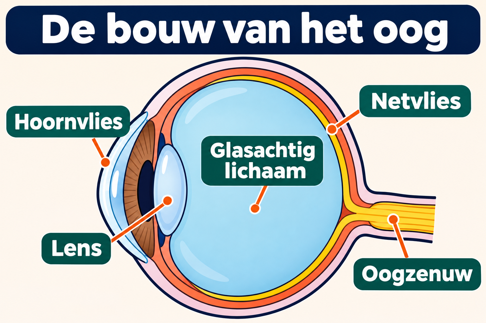

# Thema 11 Zintuigen - GT

## Basisstof 3 De ogen

### Samenvatting

De oogkas en het harde oogvlies beschermen het oog. Hoornvlies en lens buigen licht af, zodat het netvlies een scherp beeld kan ontvangen. De oogzenuw brengt impulsen van het netvlies naar de hersenen.

### Lesdoelen

**Concept:** Bescherming van het oog, oogvliezen, lens, gele vlek en blinde vlek.

**Vaardigheid:** Onderdelen van een oog in een doorsnede herkennen en hun functie uitleggen.

Je kunt de uitwendige en inwendige delen van het oog noemen, de weg van het licht volgen en uitleggen waar de oogzenuw het oog verlaat.

### Lesinhoud

#### Bescherming en beweging

| Onderdeel | Functie |
|---|---|
| Oogkas | Beschermt de oogbol met bot |
| Wenkbrauwen | Leiden zweet en ander vocht langs het oog |
| Wimpers | Helpen vuil en fel licht tegen te houden |
| Traanklier | Maakt traanvocht dat het oog vochtig houdt en stof wegspoelt |
| Oogleden | Verspreiden traanvocht bij het knipperen |
| Traanbuizen | Voeren traanvocht naar de neusholte af |
| Oogspieren | Draaien de oogbol |

#### Drie lagen rond het oog

- **Harde oogvlies.** De stevige, witte buitenlaag beschermt het oog. Aan de voorkant gaat deze laag over in het doorzichtige **hoornvlies**.
- **Vaatvlies.** De middelste laag bevat bloedvaten. Die voeren zuurstof en voedingsstoffen aan en helpen afvalstoffen af te voeren. Aan de voorkant ligt de **iris**, ook wel het regenboogvlies. De **pupil** is de opening in de iris.
- **Netvlies.** De binnenste laag bevat zintuigcellen en zenuwcellen. Bloedvaten voorzien een groot deel van het netvlies van bloed. Bij de **gele vlek** zie je het scherpst. Op de **blinde vlek** verlaat de oogzenuw het oog. Daar liggen geen zintuigcellen.

#### Van licht naar impulsen

Het hoornvlies en de **lens** buigen lichtstralen af. De lens ligt achter de iris en de pupil. Een kringspier rond de lens helpt de vorm ervan te veranderen. Het **glasachtig lichaam** is een doorzichtige gel achter de lens die het netvlies op zijn plaats helpt te houden.

Licht volgt de route hoornvlies → pupil → lens → glasachtig lichaam → netvlies. Zintuigcellen in het netvlies reageren op licht. De **oogzenuw** geleidt impulsen naar de hersenen.

### Belangrijke begrippen

- **Hoornvlies** — Doorzichtige voorkant van de buitenste ooglaag.
- **Iris** — Gekleurde ring rond de pupil.
- **Gele vlek** — Gebied van het netvlies waarmee je het scherpst ziet.
- **Blinde vlek** — Plaats waar de oogzenuw het oog verlaat en waar zintuigcellen ontbreken.
- **Glasachtig lichaam** — Doorzichtige gel tussen de lens en het netvlies.

### Praktische toepassingen

Als je huilt, kan ook je neus gaan lopen. Een deel van het traanvocht stroomt via de traanbuizen naar je neusholte.

### Zelftest

1. Hoe beschermen de oogkas en het harde oogvlies het oog?
2. Waar wordt traanvocht gemaakt, hoe verspreidt het zich en waar gaat het heen?
3. Welke twee onderdelen buigen licht af op weg naar het netvlies?
4. Wat zijn de iris en de pupil?
5. Welke laag onder het harde oogvlies bevat veel bloedvaten?
6. Waar zie je het scherpst en waar verlaat de oogzenuw het oog?
7. Welke functie heeft het glasachtig lichaam?

#### Antwoorden

1. De oogkas omsluit het oog met bot. Het harde oogvlies vormt een stevige buitenlaag rond de oogbol.
2. De traanklier maakt traanvocht. Door te knipperen verspreiden de oogleden het. Traanbuizen voeren het af naar de neusholte.
3. Het hoornvlies en de lens.
4. De iris is de gekleurde ring. De pupil is de opening in die ring.
5. Het vaatvlies.
6. Je ziet het scherpst met de gele vlek. De oogzenuw verlaat het oog bij de blinde vlek.
7. De gel vult de ruimte achter de lens en helpt het netvlies op zijn plaats te houden.

### Referentie

[Samenvatting Thema 11 Zintuigen](../samenvattingen/T4_T11_Zintuigen_-_Samenvatting.pdf), basis 3, gedrukte pagina’s 241–242.

### Afbeelding: doorsnede van het oog

#### Tekstbeschrijving van de afbeelding

Links is de voorkant van het oog. Het gebogen hoornvlies ligt vóór de iris en de lens. Achter de lens vult het glasachtig lichaam bijna de hele oogbol. Het netvlies bekleedt de oogbol van binnen langs de achterkant. Rechts verlaat de oogzenuw het oog.
