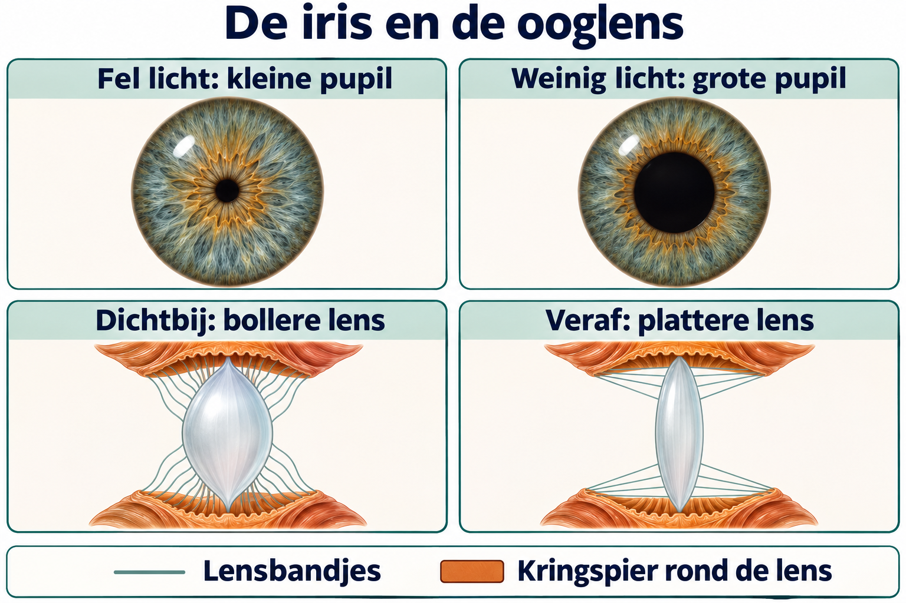

# Thema 11 Zintuigen - GT

## Basisstof 4 De iris en de ooglens

### Samenvatting

De iris bepaalt hoeveel licht het oog binnenkomt door de pupil groter of kleiner te maken. Bij scherpstellen verandert de ooglens van vorm. Het hoornvlies en de lens buigen licht zodat op het netvlies een scherp beeld ontstaat.

### Lesdoelen

**Concept:** Pupilreflex, lichtbreking en accommodatie.

**Vaardigheid:** Uitleggen hoe spieren in de iris en rond de lens verschillende functies uitvoeren.

Je kunt voorspellen wat je pupil doet bij fel of zwak licht en beschrijven hoe je dichtbij en veraf scherp ziet.

### Lesinhoud

#### Pupilreflex

De **pupilreflex** stelt automatisch de hoeveelheid licht bij die het netvlies bereikt. Bij fel licht wordt de pupil kleiner. Daardoor komt er minder licht binnen.

| Licht | Kringspieren in de iris | Lengtespieren in de iris | Pupil |
|---|---|---|---|
| Fel | Trekken samen | Ontspannen | Kleiner |
| Weinig | Ontspannen | Trekken samen | Groter |

De kringspieren lopen rond de pupil. De lengtespieren lopen als spaken van de pupil naar de buitenkant van de iris.

#### Lichtbreking en beeldvorming

Bij **lichtbreking** verandert een lichtstraal van richting. In het oog buigen vooral het hoornvlies en de lens de lichtstralen af. De lens brengt stralen dichter bij elkaar. Op het netvlies ontstaat een verkleind, omgekeerd beeld. De gezichtscentra in de grote hersenen verwerken de impulsen tot een normale waarneming.

#### Accommoderen

**Accommoderen** betekent dat het oog de lensvorm aanpast aan de afstand van het voorwerp. Hiervoor gebruikt het oog de kringspier rond de lens en de lensbandjes. De kringspier rond de lens ligt achter de iris.

| Onderdeel | Dichtbij scherp zien | Veraf scherp zien |
|---|---|---|
| Kringspier rond de lens | Trekt samen | Ontspant |
| Opening binnen die spier | Wordt kleiner | Wordt groter |
| Lensbandjes | Minder strak | Strak |
| Lens | Boller en breekt licht sterker | Platter en breekt licht minder sterk |

### Belangrijke begrippen

- **Pupilreflex** — Automatische aanpassing van de pupilgrootte aan de hoeveelheid licht.
- **Lengtespieren** — Spieren in de iris die de pupil groter maken als ze samentrekken.
- **Lichtbreking** — Verandering van de richting van lichtstralen.
- **Lensbandjes** — Vezels die aan de lens trekken en helpen bepalen hoe bol hij is.
- **Accommoderen** — De vorm van de ooglens aanpassen om scherp te zien op een bepaalde afstand.

### Praktische toepassingen

Als je van een donkere gang naar buiten loopt, valt er ineens meer licht in je ogen. Je pupillen worden kleiner. Als je daarna van een bord in de verte naar je schrift kijkt, worden je ooglenzen boller.

### Zelftest

1. Welke functie heeft de pupilreflex?
2. Welke spieren in de iris trekken samen bij plotseling fel licht?
3. Welke spieren in de iris trekken samen als het donkerder wordt?
4. Hoe ziet het beeld op het netvlies eruit in vergelijking met het voorwerp?
5. Welke veranderingen volgen elkaar op wanneer je van de verte naar een voorwerp dichtbij kijkt?
6. Hoe staan de lensbandjes wanneer je in de verte scherp ziet?

#### Antwoorden

1. De reflex regelt de hoeveelheid licht die op het netvlies valt.
2. De kringspieren in de iris trekken samen. De pupil wordt kleiner.
3. De lengtespieren trekken samen. De pupil wordt groter.
4. Het beeld op het netvlies is omgekeerd en verkleind.
5. De kringspier rond de lens trekt samen. De lensbandjes worden minder strak. De lens wordt boller.
6. Ze staan strak gespannen en trekken de lens platter.

### Referentie

[Samenvatting Thema 11 Zintuigen](../samenvattingen/T4_T11_Zintuigen_-_Samenvatting.pdf), basis 4, gedrukte pagina’s 242–243.

### Afbeelding: pupilreflex en scherpstellen

#### Tekstbeschrijving van de afbeelding

Boven links heeft de iris bij fel licht een kleine pupil. Boven rechts is de pupil bij weinig licht groter. Onder links zie je een bollere lens voor dichtbij kijken. De kringspier rond de lens is samengetrokken en de lensbandjes staan minder strak. Onder rechts zie je een plattere lens voor veraf kijken. De kringspier is ontspannen en de lensbandjes staan strakker.
