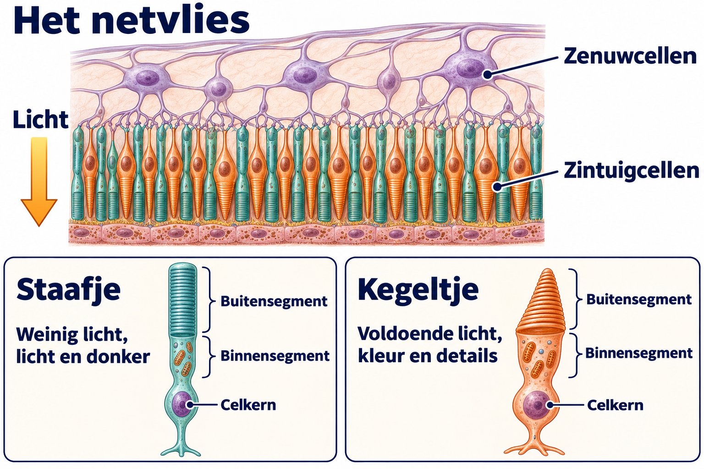

# Thema 11 Zintuigen - GT

## Basisstof 5 Het netvlies

### Samenvatting

In het netvlies zetten staafjes en kegeltjes licht om in signalen. Staafjes reageren al bij weinig licht. Kegeltjes hebben meer licht nodig en maken het mogelijk kleuren en fijne details te zien.

### Lesdoelen

**Concept:** Netvlies, staafjes, kegeltjes, gele vlek en blinde vlek.

**Vaardigheid:** Zintuigcellen vergelijken op plaats, drempelwaarde en functie.

Je kunt de weg van licht en signalen door het netvlies beschrijven en uitleggen waarom je in de schemering minder kleuren ziet.

### Lesinhoud

#### Lagen van het netvlies

Het netvlies bevat verschillende cellagen. Voor het volgen van de route kijk je naar twee groepen. Licht gaat eerst door lagen met **zenuwcellen** en bereikt daarna de **zintuigcellen**. Staafjes en kegeltjes reageren op dat licht. Na verwerking in het netvlies gaan impulsen via de oogzenuw naar de grote hersenen.

#### Staafjes en kegeltjes vergelijken

| Kenmerk | Staafjes | Kegeltjes |
|---|---|---|
| Drempelwaarde | Laag | Hoger |
| Waarneming | Verschillen tussen licht en donker | Kleur en fijne details |
| Wanneer belangrijk? | Vooral bij weinig licht | Bij voldoende licht |
| Verdeling | Over een groot deel van het netvlies, met uitzondering van het centrum van de gele vlek | Vooral dicht opeen in en rond de gele vlek |

#### Gele vlek en blinde vlek

In het centrum van de **gele vlek** liggen veel kegeltjes dicht bij elkaar. Hier zie je het scherpst. Als je naar een letter kijkt, draaien je ogen zodat het beeld van die letter op of vlak bij dit gebied valt. Bij de **blinde vlek** verlaten zenuwvezels het oog. Op die plaats liggen geen staafjes of kegeltjes.

### Belangrijke begrippen

- **Staafjes** — Lichtgevoelige zintuigcellen waarmee je verschillen tussen licht en donker waarneemt.
- **Kegeltjes** — Zintuigcellen waarmee je bij voldoende licht kleuren en details waarneemt.
- **Gele vlek** — Gebied van het netvlies voor scherp zien.
- **Blinde vlek** — Plaats waar de oogzenuw het oog verlaat. Daar zitten geen zintuigcellen.

### Praktische toepassingen

In de schemering kun je de vorm van een boom nog zien terwijl de kleuren van het blad moeilijk te onderscheiden zijn. Je staafjes zijn dan al gevoelig genoeg. Voor kleur hebben je kegeltjes meer licht nodig.

### Zelftest

1. Welke cellen passeert licht in het netvlies voordat het de zintuigcellen bereikt?
2. Welke zintuigcellen hebben de laagste drempelwaarde voor licht?
3. Waarom zie je bij weinig licht minder kleuren?
4. Welke zintuigcellen zitten dicht opeen in het centrum van de gele vlek?
5. Waarom ontstaat er geen lichtsignaal op de blinde vlek?
6. Langs welke zenuw bereiken impulsen uit het netvlies de hersenen?

#### Antwoorden

1. Licht passeert eerst de lagen met zenuwcellen.
2. De staafjes.
3. Kegeltjes hebben meer licht nodig. Bij weinig licht leveren vooral de staafjes informatie over licht en donker.
4. Kegeltjes.
5. Er zijn geen zintuigcellen op de plek waar de uitlopers van zenuwcellen het oog verlaten.
6. Via de oogzenuw.

### Referentie

[Samenvatting Thema 11 Zintuigen](../samenvattingen/T4_T11_Zintuigen_-_Samenvatting.pdf), basis 5, gedrukte pagina 243.

### Afbeelding: cellen van het netvlies

#### Tekstbeschrijving van de afbeelding

Een pijl geeft aan dat licht eerst langs de zenuwcellen gaat. Daarna bereikt het de rij zintuigcellen. Onder de doorsnede staan een staafje en een kegeltje uitvergroot. Het buitenste deel van het staafje is lang en smal. Bij het kegeltje loopt dit deel taps toe. Het staafje helpt bij weinig licht licht en donker te onderscheiden. Het kegeltje helpt bij voldoende licht kleuren en details te zien.
