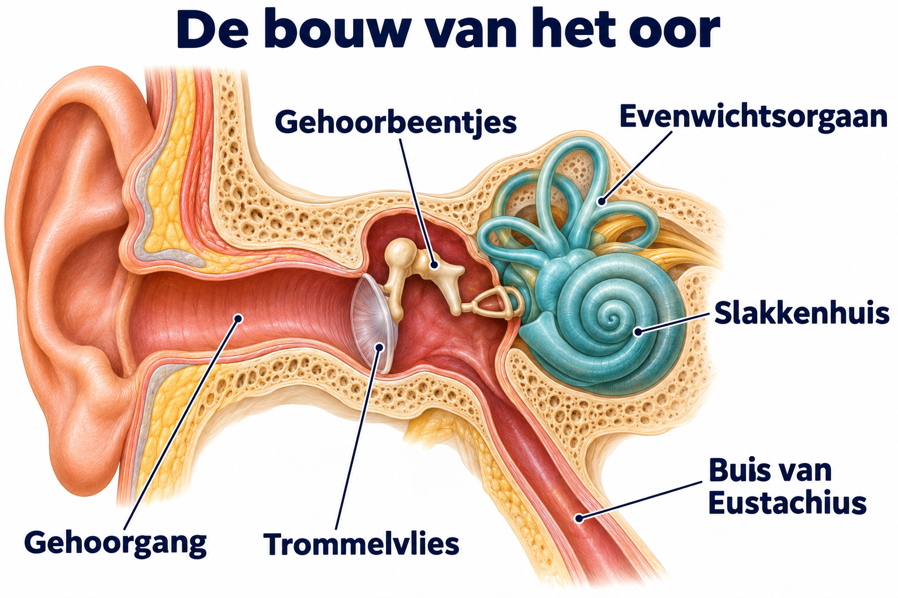

# Thema 11 Zintuigen - GT

## Basisstof 6 De oren

### Samenvatting

Je oor geeft geluidstrillingen door van de oorschelp naar het slakkenhuis. Zintuigcellen in het slakkenhuis reageren op die trillingen. De gehoorzenuw brengt impulsen naar je hersenen. Naast het slakkenhuis ligt het evenwichtsorgaan.

### Lesdoelen

**Concept:** Frequentie, amplitude, gehoorbeentjes, slakkenhuis en evenwichtsorgaan.

**Vaardigheid:** De routes van geluidstrillingen en impulsen volgen en de functie van elk deel van het oor uitleggen.

Je kunt toonhoogte en geluidssterkte koppelen aan trillingen en uitleggen hoe het gehoor, de drukregeling en het evenwichtsorgaan werken.

### Lesinhoud

#### Geluidstrillingen

Geluid bereikt het oor als trillingen van de lucht. De **frequentie** geeft aan hoeveel trillingen er per seconde zijn. Snelle trillingen geven een hoge toon. Langzame trillingen geven een lage toon. De **amplitude** is de grootste uitslag van de trilling. Bij een grotere amplitude klinkt een toon doorgaans harder.

#### Van oorschelp naar slakkenhuis

De **oorschelp** vangt geluid op. Via de **gehoorgang** bereikt het geluid het **trommelvlies**, dat meetrilt. Kliertjes in de gehoorgang maken oorsmeer. Dat beschermt de gehoorgang en helpt uitdroging te voorkomen.

Achter het trommelvlies ligt de luchtgevulde **trommelholte**, deel van het middenoor. De drie **gehoorbeentjes** geven de beweging door in deze volgorde.

Trommelvlies → hamer → aambeeld → stijgbeugel → ovaal venster van het slakkenhuis

#### Van trilling naar impuls

De stijgbeugel brengt via het **ovale venster** vloeistof in het **slakkenhuis** in beweging. Daardoor buigen de fijne uitsteeksels van bepaalde zintuigcellen, de **haarcellen**. De haarcellen geven een signaal door aan zenuwcellen. Die sturen impulsen via de **gehoorzenuw** naar de grote hersenen.

#### Luchtdruk en evenwicht

De **buis van Eustachius** verbindt de trommelholte met de keelholte. Tijdens slikken of gapen kan de buis opengaan. Zo kan de luchtdruk aan weerszijden van het trommelvlies gelijk worden.

Het **evenwichtsorgaan** ligt naast het slakkenhuis. Zintuigcellen sturen informatie over bewegingen en de stand van het hoofd via impulsen naar de hersenen. Zo helpt het orgaan je je houding en evenwicht te regelen.

### Belangrijke begrippen

- **Frequentie** — Het aantal trillingen per seconde. Bij geluid bepaalt dit de toonhoogte.
- **Amplitude** — De grootste uitslag van een trilling.
- **Gehoorbeentjes** — Hamer, aambeeld en stijgbeugel. Ze geleiden trillingen van het trommelvlies naar het ovale venster.
- **Slakkenhuis** — Deel van het binnenoor met vloeistof en gehoorzintuigcellen.
- **Buis van Eustachius** — Verbinding waarmee de luchtdruk in het middenoor kan worden bijgesteld.
- **Evenwichtsorgaan** — Deel van het binnenoor dat de stand en beweging van het hoofd registreert.

### Praktische toepassingen

Een fietser gebruikt informatie van het evenwichtsorgaan bij het nemen van een bocht. Tegelijk geven de gehoorzintuigen informatie over verkeer in de omgeving door aan de hersenen.

### Zelftest

1. Welke eigenschap van een geluidstrilling bepaalt de toonhoogte?
2. Wat verandert er aan de amplitude als je dezelfde toon harder speelt?
3. Zet de gehoorbeentjes in de volgorde waarin ze trillingen doorgeven.
4. Wat doet de stijgbeugel bij het ovale venster?
5. Hoe komt informatie over de trillingen in het slakkenhuis bij de hersenen?
6. Waarom kan slikken helpen als je oren dicht aanvoelen tijdens een vlucht?
7. Welke informatie levert het evenwichtsorgaan als je je hoofd draait?

#### Antwoorden

1. De frequentie. Hoe sneller de trillingen, hoe hoger de toon.
2. De amplitude wordt groter.
3. Hamer → aambeeld → stijgbeugel.
4. De stijgbeugel brengt via het venster vloeistof in het slakkenhuis in beweging.
5. Haarcellen reageren op de beweging. Zenuwcellen geleiden impulsen via de gehoorzenuw naar de hersenen.
6. Tijdens het slikken kan de buis van Eustachius opengaan. Daardoor kan het drukverschil aan weerszijden van het trommelvlies afnemen.
7. Informatie over de beweging en verandering van de stand van je hoofd.

### Referentie

[Samenvatting Thema 11 Zintuigen](../samenvattingen/T4_T11_Zintuigen_-_Samenvatting.pdf), basis 6, gedrukte pagina 244.

### Afbeelding: doorsnede van het oor

#### Tekstbeschrijving van de afbeelding

Links vangt de oorschelp geluid op. De gehoorgang loopt naar het trommelvlies. Achter het vlies liggen de gehoorbeentjes. Rechts ligt het spiraalvormige slakkenhuis. De boogvormige kanaaltjes van het evenwichtsorgaan liggen erboven. De buis van Eustachius loopt schuin naar beneden vanuit het middenoor naar de keelholte.
