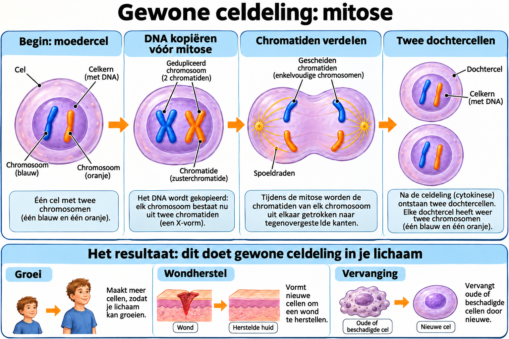

# Thema 1 Organen en cellen
## Basisstof 5 Gewone celdeling (mitose)

### Samenvatting

In deze les leer je alles over de gewone celdeling, ook wel mitose genoemd. Dit proces zorgt ervoor dat je groeit, wonden kunt herstellen en oude of beschadigde cellen kan vervangen door nieuwe. Gewone celdeling begint met het verdubbelen van het DNA, waarna de celkern en uiteindelijk de hele cel zich deelt. Hierdoor ontstaan uit één moedercel twee dochtercellen, die precies dezelfde informatie en aantal chromosomen bevatten als de oorspronkelijke cel.

### Lesdoelen

**Concept:** Mitose en behoud van erfelijke informatie.

**Vaardigheid:** Een biologisch proces beschrijven.

Je kunt aan het einde van de les het verloop en de functie van mitose uitleggen en beschrijven hoe dochtercellen dezelfde erfelijke informatie krijgen.

<!--
- Je kunt beschrijven hoe gewone celdeling (mitose) verloopt.
- Je kunt uitleggen wat het doel van mitose is.
- Je kunt de kenmerken van mitose benoemen.
-->

### Lesinhoud

**Wat is gewone celdeling (mitose)?**  
Gewone celdeling, mitose, is het proces waarbij uit één moedercel twee nieuwe dochtercellen ontstaan. Dit is belangrijk voor groei, het vervangen van oude cellen en genezing van wonden.

**Het proces van mitose bestaat uit drie hoofdfasen:**

1. **Kerndeling**
   - De chromosomen (dus het DNA) worden eerst gekopieerd, zodat elke dochtercel dezelfde informatie krijgt.
   - Na het kopiëren spiraliseren de DNA-ketens, waardoor de chromosomen korter en dikker worden en zichtbaar zijn in een microscoop.
   - Tijdens de kerndeling worden de gekopieerde chromosomen uit elkaar getrokken naar de twee uiteinden van de cel.

2. **Celdeling**
   - Het cytoplasma deelt zich, er groeit een celmembraan tussen de twee kernen waardoor twee cellen ontstaan.

3. **Plasmagroei**
   - De nieuwe dochtercellen nemen extra cytoplasma op en groeien uit tot even grote cellen als de oorspronkelijke moedercel.

**Kenmerken van mitose:**
- Elke dochtercel heeft evenveel chromosomen als de moedercel.
- De erfelijke informatie blijft in beide cellen gelijk.
- Mitose zorgt voor groei, herstel en vervanging van cellen【5:1†3GTbvj_thema_1 edit.pdf】【5:2†3GTbvj_thema_1 edit.pdf】【5:5†3GTbvj_thema_1 edit.pdf】【5:7†598785-01_BVJ_3GT_sv1.pdf】.

### Praktische toepassingen

- **Genezing van wonden:** Als je je snijdt, zorgt mitose ervoor dat er nieuwe huidcellen worden gevormd om het wondje te dichten.
- **Groeien:** Iedereen begint als een kleine cel (bij de bevruchting) en groeit door celdeling uit tot een volwassen persoon met heel veel cellen.
- **Vervangen van cellen:** Je huid en je darmen vernieuwen zich constant door celdeling.

### Zelftest

1. Wat is het doel van gewone celdeling (mitose)?
2. Wat gebeurt er met de chromosomen vóór de kerndeling?
3. Waarom zijn chromosomen tijdens mitose zichtbaar onder een microscoop?
4. Hebben de dochtercellen na mitose evenveel chromosomen als de moedercel?
5. Noem een voorbeeld van een situatie in het dagelijks leven waarbij mitose belangrijk is.

#### Antwoorden

1. Het doel is de vorming van nieuwe cellen voor groei, herstel en vervanging.
2. Elk chromosoom maakt een kopie van zichzelf, zodat er straks evenveel erfelijke informatie in beide dochtercellen komt te zitten.
3. Omdat de DNA-ketens zich spiraliseren (oprollen), worden de chromosomen korter en dikker en dus zichtbaar.
4. Ja, iedere dochtercel heeft evenveel chromosomen en dezelfde erfelijke informatie als de moedercel.
5. Het herstel van een wondje, waarbij nieuwe huidcellen worden aangemaakt door mitose.

### Afbeelding: Gewone celdeling: mitose

#### Tekstbeschrijving van de afbeelding

- **Moedercel:** het vereenvoudigde voorbeeld begint met één cel met twee verschillende chromosomen. Vóór mitose wordt het DNA gekopieerd. Elk chromosoom heeft dan twee zusterchromatiden.
- **Verdeling:** tijdens mitose gaan de zusterchromatiden uit elkaar. Naar elke kant gaat één kopie van elk van de twee oorspronkelijke chromosomen.
- **Dochtercellen:** na deling van de hele cel zijn er twee cellen, elk weer met twee chromosomen. De tekening toont een oefenmodel, niet het werkelijke aantal in een menselijke cel.
- **Toepassingen:** onderaan staan groei, herstel van een wond en vervanging van oude of beschadigde cellen.
