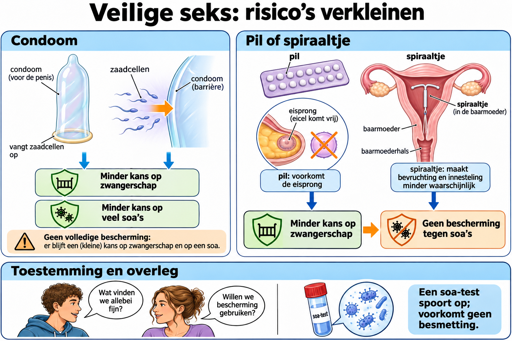

# Thema 2 Voortplanting en seksualiteit  
## Basisstof 7 Veilige seks  

### Samenvatting
In deze basisstof leer je wat **veilige seks** betekent en waarom het belangrijk is.  
Veilige seks verkleint de kans op een **ongewenste zwangerschap** en op **seksueel overdraagbare aandoeningen (soa's)**. Bescherming is niet absoluut.
Je leert wat **voorbehoedsmiddelen** zijn, hoe ze werken en wat het verschil is tussen **veilige** en **onveilige seks**.  

### Lesdoelen

**Concept:** Seksuele gezondheid, soa’s en anticonceptie.

**Vaardigheid:** Vergelijken en keuzes onderbouwen.

Je kunt aan het einde van de les uitleggen hoe je soa’s en ongewenste zwangerschap kunt voorkomen en beschermingsmiddelen vergelijken.

<!--
- Je weet wat veilige seks is en waarom het belangrijk is.  
- Je kunt uitleggen wat voorbehoedsmiddelen zijn en hoe ze werken.  
- Je kunt voorbeelden noemen van veilige en onveilige seks.  
- Je begrijpt hoe soa’s worden overgedragen en hoe je ze voorkomt.  
-->

### Lesinhoud
#### Wat is veilige seks?
Veilige seks betekent dat je seks hebt op een manier waarbij je jezelf en de ander **beschermt tegen zwangerschap en soa’s**.  
Het belangrijkste is dat het **vrijwillig** gebeurt, **met toestemming** en **met bescherming**.

#### Voorbehoedsmiddelen
**Voorbehoedsmiddelen** (anticonceptie) zijn middelen die een zwangerschap voorkomen.  
De bekendste zijn:
- **Condoom**: beschermt tegen zwangerschap én soa’s.  
- **De pil**: voorkomt dat er een eicel vrijkomt bij de vrouw.  
- **Spiraaltje**: verkleint de kans op zwangerschap, maar beschermt niet tegen soa's.
- **Pleister of prikpil**: bevatten hormonen die de eisprong stoppen.  

Van deze voorbehoedsmiddelen verkleint een condoom ook de kans op veel soa's.

#### Wat is onveilige seks?
Onveilige seks is seks zonder bescherming, waardoor de kans bestaat op:
- **Zwangerschap**  
- **Soa’s**, zoals chlamydia, hiv of gonorroe  

Daarom is het belangrijk om altijd goed na te denken en op tijd **voorbehoedsmiddelen te gebruiken**.

#### Wat zijn soa’s?
Een **soa** is een **seksueel overdraagbare aandoening**: een ziekte die je kunt krijgen door seksueel contact.  
Voorbeelden zijn:
- **Chlamydia**  
- **Hiv**  
- **Gonorroe**  
- **Herpes**

Een **condoom** verkleint de kans op veel soa's. Een soa-test kan een infectie opsporen; de test zelf voorkomt geen besmetting.

### Praktische toepassingen
- Door kennis over veilige seks kun je verantwoordelijkheid nemen voor jezelf en anderen.  
- Je leert hoe je gezonde keuzes maakt bij relaties en seksualiteit.  
- Je weet dat praten over seks en bescherming normaal en belangrijk is.  

---

### Zelftest

1. Wat wordt bedoeld met veilige seks?
2. Waarom is een condoom belangrijk bij veilige seks?
3. Noem drie voorbehoedsmiddelen.
4. Wat is het verschil tussen de pil en het condoom?
5. Wat kan het gevolg zijn van onveilige seks?
6. Noem twee soa’s.
7. Hoe kun je een soa voorkomen?
8. Waarom is toestemming belangrijk bij seks?
9. Wat doet een spiraaltje?
10. Waarom is praten over seks belangrijk?
11. Wat is onveilige seks?
12. Wat betekent soa?

#### Antwoorden

1. Seks waarbij bescherming wordt gebruikt tegen soa’s en zwangerschap.
2. Goed gebruik verkleint de kans op veel soa's en op zwangerschap.
3. Condoom, pil, spiraaltje.
4. De pil voorkomt de eisprong; het condoom voorkomt contact tussen zaadcellen en eicel.
5. Ongewenste zwangerschap of een soa.
6. Chlamydia en hiv.
7. Een condoom verkleint de kans op veel soa's. Een test kan een infectie opsporen, maar biedt geen bescherming tijdens seks.
8. Omdat seks altijd vrijwillig moet zijn.
9. Een spiraaltje verkleint de kans op zwangerschap, maar beschermt niet tegen soa's.
10. Omdat het helpt misverstanden en risico’s te voorkomen.
11. Seks zonder bescherming tegen zwangerschap of soa’s.
12. Seksueel overdraagbare aandoening.

---

### Referentie
Bron: *3GTbvj_thema_1 edit.pdf* — Biologiemethode “Organen en Cellen”, thema 2 voortplanting en seksualiteit, basisstof 2 (Veilige seks).

### Afbeelding: Veilige seks: risico’s verkleinen

#### Tekstbeschrijving van de afbeelding

- **Condoom:** links toont de tekening een barrière. Goed gebruik verkleint de kans op zwangerschap en op veel soa's. De bescherming is niet absoluut.
- **Pil en spiraaltje:** rechts staan twee vormen van anticonceptie die de kans op zwangerschap verkleinen, maar niet tegen soa's beschermen.
- **Toestemming en overleg:** onderaan praten twee mensen over grenzen en bescherming. Een soa-test kan een infectie opsporen; een test voorkomt zelf geen besmetting.

Bron bij de afbeelding: [Thuisarts - Condooms gebruiken](https://www.thuisarts.nl/condooms/ik-wil-condooms-gaan-gebruiken).
