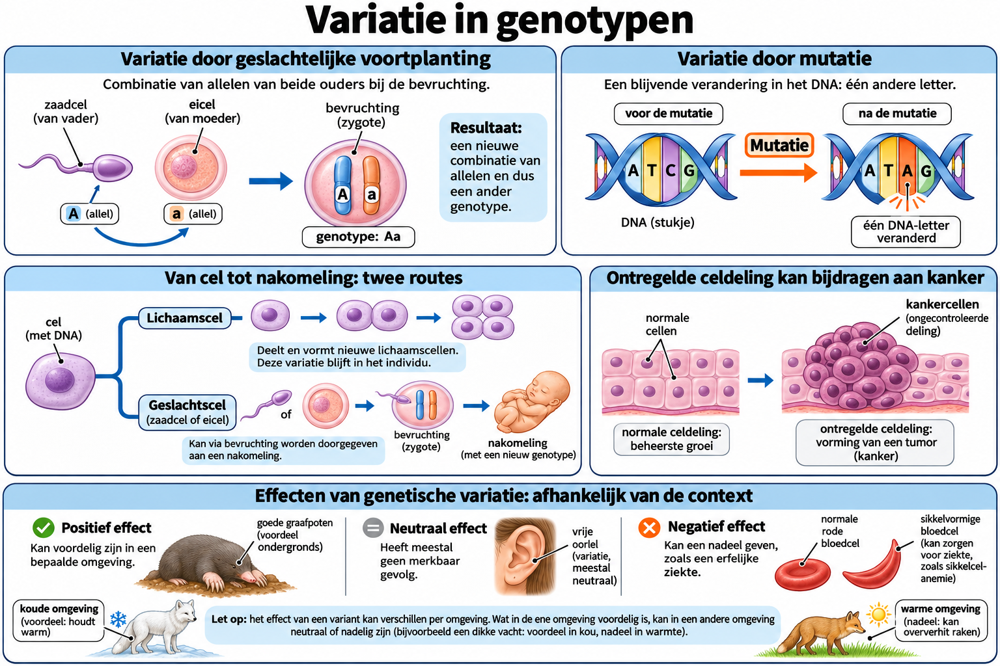

# Thema 3 Erfelijkheid en Evolutie
## Basistof 5 Variatie in genotypen

### Samenvatting
In deze les leer je hoe verschillen in genotypen ontstaan bij organismen. Je ontdekt dat variatie niet alleen komt door geslachtelijke voortplanting, maar ook door mutaties. Ook leer je hoe kanker kan ontstaan wanneer cellen ongecontroleerd gaan delen. Deze kennis helpt je te begrijpen waarom geen twee organismen precies gelijk zijn en waarom erfelijke ziekten soms wel of niet worden doorgegeven.

### Lesdoelen

**Concept:** Genetische variatie, mutaties en kanker.

**Vaardigheid:** Oorzaken en gevolgen verklaren.

Je kunt aan het einde van de les uitleggen hoe voortplanting en mutaties genetische variatie veroorzaken en wanneer mutaties erfelijk of schadelijk zijn.

<!--
Na deze les kun je:
- uitleggen hoe geslachtelijke voortplanting zorgt voor variatie in genotypen  
- uitleggen hoe ongeslachtelijke voortplanting werkt en waarom daar weinig variatie is  
- beschrijven wat een mutatie is  
- uitleggen wanneer een mutatie erfelijk is  
- uitleggen hoe kanker ontstaat  
- voorbeelden herkennen van mutagene invloeden  
-->

---

### Lesinhoud

### Ongeslachtelijke voortplanting
Bij **ongeslachtelijke voortplanting** groeit een deel van een organisme uit tot een nieuw individu.  
Dit gebeurt bijvoorbeeld bij:
- **stekken van planten**  
- **aardappelknollen**

Omdat dit gebeurt via **mitose**, blijven alle genotypen hetzelfde.  
Dus:
- nakomelingen zijn genetisch identiek aan de ouder  
- verschillen in uiterlijk kunnen wél ontstaan door **milieu-invloeden** (bijv. zonlicht, voeding)

### Geslachtelijke voortplanting
Bij **geslachtelijke voortplanting** versmelten twee geslachtscellen.  
Deze geslachtscellen hebben elk **verschillende genotypen** door meiose.  
Daarom ontstaat:
- **variatie in genotypen**  
- en daardoor **variatie in fenotypen**

Dit verklaart waarom broers en zussen van elkaar verschillen.

### Mutaties
Een **mutatie** is een *plotselinge verandering in het DNA*.

Mutaties kunnen ontstaan door:
- fouten tijdens de celdeling  
- mutagene invloeden zoals:
  - uv-straling  
  - röntgenstraling  
  - sigarettenrook  
  - asbest  

#### Mutatie in een lichaamscel
- blijft beperkt tot die ene cel en de dochtercellen ervan  
- wordt **niet** doorgegeven aan nakomelingen  

#### Mutatie in een geslachtscel
- komt **wel** in alle cellen van de nakomeling terecht  
- kan erfelijke gevolgen hebben  

### Mutanten
Wanneer een gemuteerd allel zichtbaar wordt in het fenotype, noem je het organisme een **mutant**.  
Voorbeeld uit de basisstof:
- **albino’s** (mutatie in pigmentgen)

### Kanker
Kanker ontstaat wanneer:
1. In een cel mutaties optreden  
2. Die mutaties ervoor zorgen dat de cel **ongecontroleerd gaat delen**

Dit leidt tot:
- een **tumor**  
  - goedaardig: groeit langzaam, dringt geen weefsels binnen  
  - kwaadaardig: groeit snel, dringt omliggend weefsel binnen → kanker  

Bij **uitzaaiing** komen kankercellen in bloed of lymfe terecht en vormen elders nieuwe tumoren.

---

### Praktische toepassingen
- Bij planten vermeerderen kwekers gewenste eigenschappen door ongeslachtelijke voortplanting.  
- Variatie door geslachtelijke voortplanting maakt populaties beter bestand tegen veranderingen in het milieu.  
- Inzicht in mutaties helpt bij het begrijpen van erfelijke ziekten en bij kankeronderzoek.  
- Veilig omgaan met straling en schadelijke stoffen verkleint de kans op mutaties.

---

### Zelftest

1. Wat is het verschil tussen geslachtelijke en ongeslachtelijke voortplanting en waarom lijken ongeslachtelijke nakomelingen genetisch sterk op elkaar?
2. Wat zijn mutagene invloeden?
3. Wat is een mutant?
4. Wat gebeurt er bij een mutatie in een geslachtscel?
5. Hoe ontstaat een tumor?
6. Noem één voorbeeld van een mutagene invloed uit de basisstof.
7. Waarom kunnen broers en zussen verschillend fenotype hebben?
8. Hoe kan kanker zich door het lichaam verspreiden?
9. Wat is het gevolg van een mutatie in een lichaamscel?
10. Waarom ontstaan er bij geslachtelijke voortplanting veel verschillende genotypen?
11. Wat is een mutatie?
12. Wat is het verschil tussen een goedaardige en een kwaadaardige tumor?

#### Antwoorden

1. Geslachtscellen versmelten bij geslachtelijke voortplanting, bij ongeslachtelijke niet. Omdat ze hetzelfde genotype hebben als de ouder.
2. Invloeden die de kans op mutaties vergroten.
3. Een organisme waarin een mutatie zichtbaar is in het fenotype.
4. De mutatie komt in elke cel van de nakomeling terecht.
5. Door ongecontroleerde celdeling door mutaties.
6. UV-straling, röntgenstraling, sigarettenrook, asbest.
7. Door variatie in genotypen die ontstaat bij geslachtelijke voortplanting.
8. Via bloed of lymfe → uitzaaiing.
9. Alleen die cel en de dochtercellen veranderen, niet het hele organisme.
10. Omdat geslachtscellen verschillende allelen bevatten door meiose en willekeurig samensmelten.
11. Een plotselinge verandering in het DNA.
12. Goedaardig groeit langzaam en dringt geen weefsels binnen; kwaadaardig groeit snel, dringt weefsels binnen en kan uitzaaien.

---

### Referentie
Gebaseerd op *Thema 3, Basistof 5 – Variatie in genotypen* uit het geüploade document.

### Afbeelding: Variatie in genotypen

#### Tekstbeschrijving van de afbeelding

Linksboven komen A uit een zaadcel en a uit een eicel samen in de bevruchte eicel. Rechtsboven toont ATCG naar ATAG een voorbeeld van een mutatie. In het midden splitst een schema in twee routes: een mutatie in een lichaamscel kan meegaan naar nieuwe lichaamscellen, terwijl een mutatie in een geslachtscel via bevruchting kan worden doorgegeven. Daarnaast staat een opeenhoping van cellen als voorbeeld van wat ontregelde celdeling kan veroorzaken. Onderaan staan voordelige, neutrale en nadelige effecten naast elkaar. Een dikke vacht kan in kou voordelig zijn en in warmte nadelig.
