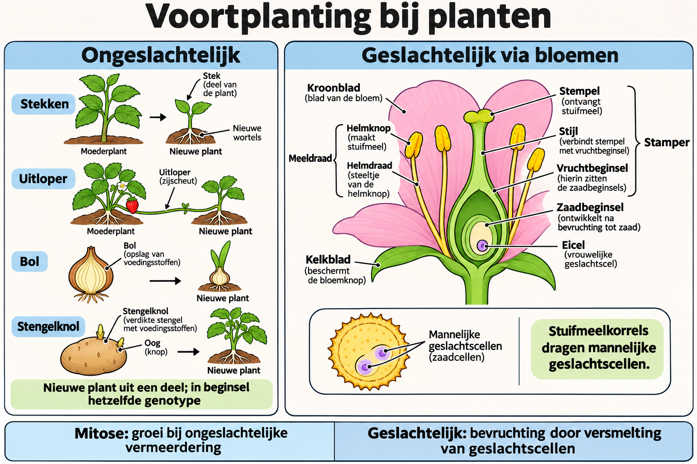

# Thema 9 Planten

## Basisstof 4 Voortplanting

### Samenvatting

Planten kunnen zich ongeslachtelijk en geslachtelijk voortplanten. Bij ongeslachtelijke voortplanting groeit een deel van een plant uit tot een nieuwe plant. De nakomelingen hebben hetzelfde genotype als de ouder. Bij geslachtelijke voortplanting ontstaan nieuwe planten door versmelting van geslachtscellen. Bij zaadplanten kan dit gebeuren via bloemen.

### Lesdoelen

**Concept:** Geslachtelijke en ongeslachtelijke voortplanting bij planten.

**Vaardigheid:** Vergelijken en functies benoemen.

Je kunt aan het einde van de les voortplantingswijzen bij planten vergelijken en de delen en functies van een bloem beschrijven.

<!--
- Je kunt uitleggen wat ongeslachtelijke voortplanting is.
- Je kunt voorbeelden noemen van ongeslachtelijke voortplanting bij zaadplanten.
- Je kunt uitleggen wat geslachtelijke voortplanting is.
- Je kunt de belangrijkste delen van een bloem noemen met hun functies.
-->

### Lesinhoud

Bij **ongeslachtelijke voortplanting** groeit een deel van een individu uit tot een nieuw individu. Dit gebeurt door **mitose**, gewone celdeling. De nakomelingen hebben hetzelfde genotype als de ouder.

Zaadplanten kunnen zich op verschillende manieren ongeslachtelijk voortplanten:

- **Stekken**: een stuk van een stengel of blad wordt afgesneden en groeit uit tot een nieuwe plant, bijvoorbeeld bij siernetel.
- **Knollen**: in verdikte stengels of wortels ontstaan knoppen, bijvoorbeeld bij schedefonteinkruid.
- **Bollen**: in verdikte bladeren ontstaan knoppen, bijvoorbeeld bij de tulp.
- **Enten**: een deel van een plant, de ent, wordt geplaatst op een deel van een andere plant, de onderstam, bijvoorbeeld bij druiven.
- **Uitlopers**: boven de grond ontstaan horizontaal groeiende stengels, bijvoorbeeld bij de aardbeienplant.
- **Wortelstokken**: onder de grond ontstaan horizontaal groeiende stengels, bijvoorbeeld bij lelietje-van-dalen.

Bij **geslachtelijke voortplanting** ontstaan nieuwe individuen door bevruchting: versmelting van geslachtscellen. **Meiose**, reductiedeling, is een ander proces waarbij het chromosoomaantal wordt gehalveerd. Beide processen spelen een rol in de levenscyclus. Nakomelingen kunnen nieuwe combinaties van erfelijke informatie hebben. Bij zaadplanten vindt geslachtelijke voortplanting plaats via bloemen.

Een bloem bestaat uit verschillende delen.

De **bloemkelk** bestaat uit **kelkbladeren**. Deze zijn meestal groen. Ze beschermen de bloem in de knop tegen uitdroging en kou.

De **bloemkroon** bestaat uit **kroonbladeren**. Deze zijn vaak groot en opvallend gekleurd, maar soms klein en groen. Als kroonbladeren opvallend gekleurd zijn, lokken ze insecten aan.

De **meeldraad** is het mannelijke voortplantingsorgaan van een bloem. Een meeldraad bestaat uit een **helmdraad** en een **helmknop**. In de helmknop ontstaan via meiose en verdere ontwikkeling stuifmeelkorrels. Die kunnen mannelijke geslachtscellen vormen en overbrengen.

De **stamper** is het vrouwelijke voortplantingsorgaan van een bloem. Een stamper bestaat uit een **stempel**, een **stijl** en een **vruchtbeginsel** met een of meer **zaadbeginsels**. In de zaadbeginsels ontstaan door meiose eicellen. In elk zaadbeginsel ontstaat één eicel met kern.

### Praktische toepassingen

Je kunt ongeslachtelijke voortplanting herkennen als mensen planten vermeerderen door stekken of enten. Zo kan uit een stukje plant een nieuwe plant groeien.

Bij bloemen kun je beter begrijpen waarom sommige bloemen opvallende kleuren hebben. Kroonbladeren kunnen insecten aanlokken. Ook kun je in een bloem de mannelijke en vrouwelijke voortplantingsorganen herkennen: de meeldraden en de stamper.

### Begrippen

- **Bloemkelk**: bestaat uit kelkbladeren.
- **Bloemkroon**: bestaat uit kroonbladeren.
- **Bol**: verdikt blad, bijvoorbeeld de rokken van een ui.
- **Enten**: een deel van de ene plant op een deel van een andere plant plaatsen.
- **Helmdraad**: onderdeel van een meeldraad; draagt de helmknop.
- **Helmknop**: onderdeel van een meeldraad; hierin ontstaat stuifmeel.
- **Kelkbladeren**: vaak groene delen van een bloem; beschermen de bloem als deze nog in de knop zit.
- **Knol**: verdikte stengel of wortel, bijvoorbeeld aardappels.
- **Kroonbladeren**: vaak opvallend gekleurde delen van een bloem; lokken insecten aan.
- **Meeldraad**: mannelijk voortplantingsorgaan van planten.
- **Stamper**: vrouwelijk voortplantingsorgaan van planten; bestaat uit stempel, stijl en vruchtbeginsel.
- **Stekken**: een stuk van een stengel of blad afsnijden om uit te laten groeien tot een nieuwe plant.
- **Stempel**: bovenste deel van een stamper; hier komt bij bestuiving stuifmeel terecht.
- **Stijl**: middelste deel van een stamper; hier groeit de stuifmeelbuis doorheen naar de eicel.
- **Stuifmeel**: bestaat uit stuifmeelkorrels.
- **Stuifmeelkorrel**: korreltje dat mannelijke geslachtscellen kan vormen en overbrengen.
- **Uitloper**: horizontaal groeiende stengel boven de grond waaraan jonge planten ontstaan.
- **Vruchtbeginsel**: onderste deel van een stamper; hierin liggen de zaadbeginsels; groeit na bevruchting uit tot een vrucht.
- **Wortelstok**: horizontaal groeiende stengel onder de grond waaraan jonge planten ontstaan.
- **Zaadbeginsel**: hierin ontstaat een eicel; groeit na bevruchting uit tot een zaad.

### Zelftest

1. Wat is ongeslachtelijke voortplanting?
2. Door welke celdeling vindt ongeslachtelijke voortplanting plaats?
3. Noem drie manieren waarop zaadplanten zich ongeslachtelijk kunnen voortplanten.
4. Wat is enten?
5. Wat is geslachtelijke voortplanting?
6. Wat is het verschil tussen meiose en bevruchting?
7. Wat is de functie van kroonbladeren als ze opvallend gekleurd zijn?
8. Uit welke onderdelen bestaat een meeldraad?
9. Waar ontstaan stuifmeelkorrels?
10. Waar ontstaan eicellen bij zaadplanten?
11. Welk genotype hebben nakomelingen bij ongeslachtelijke voortplanting?
12. Wat is de functie van kelkbladeren?
13. Waaruit bestaat een stamper?

#### Antwoorden

1. Ongeslachtelijke voortplanting is voortplanting waarbij een deel van een individu uitgroeit tot een nieuw individu.
2. Door mitose, gewone celdeling.
3. Bijvoorbeeld stekken, knollen, bollen, enten, uitlopers en wortelstokken.
4. Enten is het plaatsen van een deel van een plant, de ent, op een deel van een andere plant, de onderstam.
5. Geslachtelijke voortplanting is voortplanting waarbij nieuwe individuen ontstaan uit versmelting van geslachtscellen.
6. Meiose is celdeling waarbij het chromosoomaantal wordt gehalveerd. Bevruchting is versmelting van geslachtscellen.
7. Ze lokken insecten aan.
8. Uit helmdraad en helmknop.
9. In de helmknop.
10. In de zaadbeginsels.
11. Ze hebben hetzelfde genotype als de ouder.
12. Ze beschermen de bloem in de knop tegen uitdroging en kou.
13. Uit stempel, stijl en vruchtbeginsel met een of meer zaadbeginsels.

### Afbeelding: voortplanting bij planten

#### Tekstbeschrijving van de afbeelding

- **Ongeslachtelijk:** uit een deel van een plant kan een nieuwe plant ontstaan, bijvoorbeeld via stekken, uitlopers, bollen of stengelknollen. Groei gebeurt door mitose. De nieuwe plant heeft in beginsel hetzelfde genotype, afgezien van mogelijke mutaties.
- **Bloem:** kroonbladeren kunnen insecten aantrekken en kelkbladeren beschermen de knop. Een meeldraad bestaat uit helmdraad en helmknop. De stamper bestaat uit stempel, stijl en vruchtbeginsel.
- **Geslachtscellen:** stuifmeelkorrels dragen mannelijke geslachtscellen; een stuifmeelkorrel is niet zelf één geslachtscel. In het vruchtbeginsel liggen zaadbeginsels met elk een eicel.
- **Geslachtelijk:** bij bevruchting versmelten geslachtscellen. Meiose is een ander proces, betrokken bij de vorming van haploïde voortplantingscellen. Geslachtelijke voortplanting kan nieuwe combinaties van erfelijke informatie opleveren.

Pijlen en opschriften geven de betekenis aan; kleur onderscheiden is niet nodig.
