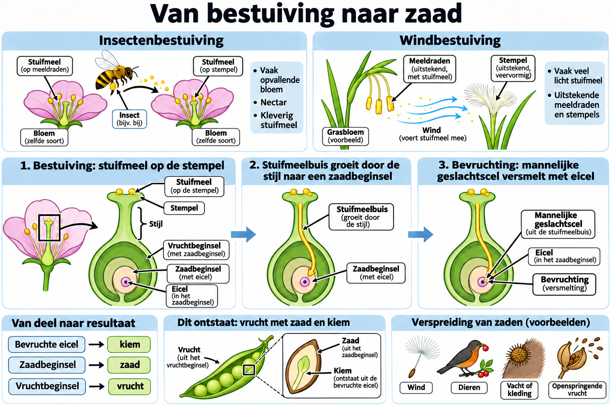

# Thema 9 Planten

## Basisstof 5 Bestuiving, bevruchting en verspreiding

### Samenvatting

Bij bestuiving komt stuifmeel van een meeldraad op de stempel van een bloem van dezelfde plantensoort. Bestuiving kan gebeuren door insecten of door de wind. Na bestuiving kan bevruchting plaatsvinden. Daarna ontstaan uit het zaadbeginsel een zaad en uit het vruchtbeginsel een vrucht. Vruchten en zaden kunnen op verschillende manieren worden verspreid.

### Lesdoelen

**Concept:** Bestuiving, bevruchting en verspreiding.

**Vaardigheid:** Processen vergelijken en aanpassingen verklaren.

Je kunt aan het einde van de les bestuivingswijzen vergelijken en uitleggen hoe bevruchting en de verspreiding van zaden en vruchten verlopen.

<!--
- Je kunt uitleggen wat bestuiving is.
- Je kunt het verschil beschrijven tussen kruisbestuiving en zelfbestuiving.
- Je kunt kenmerken noemen van insectenbloemen en windbloemen.
- Je kunt uitleggen hoe bevruchting bij zaadplanten verloopt.
- Je kunt manieren noemen waarop vruchten en zaden worden verspreid.
-->

### Lesinhoud

**Bestuiving** betekent dat stuifmeel van een meeldraad op de stempel van een bloem terechtkomt. Het stuifmeel moet afkomstig zijn van dezelfde plantensoort.

Er zijn twee vormen van bestuiving:

- **Kruisbestuiving**: stuifmeel van een meeldraad komt op een stempel van een bloem van een andere plant van dezelfde soort.
- **Zelfbestuiving**: stuifmeel van een meeldraad komt op de stempel van dezelfde plant.

Bestuiving kan plaatsvinden door insecten of door de wind.

**Insectenbloemen** worden bestoven door insecten. Ze hebben meestal grote bloemen. De kroonbladeren zijn meestal opvallend gekleurd. De bloemen geuren vaak en hebben vaak nectar. De stuifmeelkorrels zijn ruw en kleverig. De meeldraden produceren in verhouding weinig stuifmeelkorrels. De helmknoppen en stempels zitten binnen de bloemen. De stempels zijn meestal klein.

**Windbloemen** worden bestoven door de wind. Ze hebben meestal kleine bloemen. De kroonbladeren zijn meestal groen. De bloemen geuren niet en hebben geen nectar. De stuifmeelkorrels zijn licht en glad. De meeldraden produceren heel veel stuifmeelkorrels. De helmknoppen en stempels steken buiten de bloemen uit. De stempels zijn groot en veervormig.

Na bestuiving kan **bevruchting** plaatsvinden. Uit een geschikte stuifmeelkorrel groeit een stuifmeelbuis naar een zaadbeginsel. Via de buis bereiken mannelijke geslachtscellen de eicel. Stuifmeel moet bij de bloem passen; afkomstig zijn van dezelfde soort is niet altijd voldoende om bevruchting te laten slagen.

Een mannelijke geslachtscel versmelt met de eicel. Daarbij versmelten hun kernen en ontstaat een bevruchte eicel.

Na de bevruchting veranderen delen van de bloem:

- Uit een bevruchte eicel ontstaat een kiempje.
- Uit een kiempje kan een kiemplantje ontstaan.
- Uit een zaadbeginsel met een bevruchte eicel ontstaat een zaad.
- Uit een vruchtbeginsel ontstaat een vrucht.

Vruchten en zaden kunnen op verschillende manieren worden verspreid:

- **Door de wind**: vruchten en zaden hebben pluis of vleugels, bijvoorbeeld bij de paardenbloem.
- **Door dieren**: vruchten zoals bessen worden gegeten; de zaden worden onverteerd uitgepoept, bijvoorbeeld bij de lijsterbes.
- **Door dieren en mensen**: zaden blijven kleven in vacht of kleding en laten ergens anders weer los, bijvoorbeeld bij de grote klis.
- **Door de plant zelf**: vruchten springen open, waardoor zaden worden weggeslingerd, bijvoorbeeld bij klein springzaad.

### Praktische toepassingen

Als je bloemen bekijkt, kun je vaak zien of ze door insecten of door de wind worden bestoven. Grote, opvallend gekleurde en geurende bloemen passen bij insectenbestuiving. Kleine, groene bloemen zonder geur passen vaak bij windbestuiving.

Ook kun je in de natuur herkennen hoe zaden zich verspreiden. Pluisjes aan zaden wijzen op verspreiding door de wind. Kleverige zaden kunnen blijven hangen aan kleding of vacht.

### Begrippen

- **Bestuiving**: overbrengen van stuifmeel van een meeldraad op de stempel van een stamper van dezelfde soort.
- **Insectenbloem**: bloem waarvan het stuifmeel door insecten wordt overgebracht.
- **Kiem**: hieruit kan een kiemplantje ontstaan.
- **Vrucht**: deel van een plant waar zaden in zitten.
- **Windbloem**: bloem waarvan het stuifmeel door de wind wordt overgebracht.
- **Zaad**: ontstaat uit het zaadbeginsel; hierin bevindt zich het kiempje.
- **Zaadverspreiding**: verspreiden van vruchten met zaden door de wind, dieren, mensen of de plant zelf.

### Zelftest

1. Wat gebeurt er bij bestuiving?
2. Wat is het verschil tussen kruisbestuiving en zelfbestuiving?
3. Door welke twee manieren kan bestuiving plaatsvinden?
4. Noem drie kenmerken van insectenbloemen.
5. Noem drie kenmerken van windbloemen.
6. Wat groeit er na bestuiving uit een stuifmeelkorrel?
7. Wat gebeurt er bij bevruchting met de kernen van de mannelijke geslachtscel en de eicel?
8. Wat ontstaat uit een bevruchte eicel?
9. Wat ontstaat uit een vruchtbeginsel?
10. Noem vier manieren waarop vruchten en zaden kunnen worden verspreid.
11. Wat ontstaat uit een zaadbeginsel na bevruchting?

#### Antwoorden

1. Stuifmeel van een meeldraad komt op de stempel van een bloem van dezelfde plantensoort.
2. Bij kruisbestuiving komt stuifmeel op een bloem van een andere plant van dezelfde soort; bij zelfbestuiving komt stuifmeel op de stempel van dezelfde plant.
3. Door insecten of door de wind.
4. Bijvoorbeeld: meestal groot, opvallend gekleurde kroonbladeren, geur, nectar, ruwe en kleverige stuifmeelkorrels.
5. Bijvoorbeeld: meestal klein, groene kroonbladeren, geen geur, geen nectar, lichte en gladde stuifmeelkorrels.
6. Een stuifmeelbuis.
7. De kern van de mannelijke geslachtscel versmelt met de eicelkern.
8. Een kiempje.
9. Een vrucht.
10. Door wind, door dieren die vruchten eten, via vacht of kleding, en door de plant zelf met openspringende vruchten.
11. Uit een zaadbeginsel ontstaat een zaad.

### Afbeelding: bestuiving, bevruchting en zaadvorming

#### Tekstbeschrijving van de afbeelding

- **Bestuiving:** stuifmeel komt op de stempel van een bloem van dezelfde soort. Bij insectenbestuiving helpen vaak opvallende kroonbladeren, nectar en kleverig stuifmeel. Windbloemen hebben vaak veel licht stuifmeel en uitstekende helmknoppen en stempels.
- **Van stuifmeel naar eicel:** uit een geschikte stuifmeelkorrel groeit een stuifmeelbuis door de stijl naar een zaadbeginsel in het vruchtbeginsel. Een mannelijke geslachtscel bereikt via die buis de eicel.
- **Bevruchting en vorming:** uit de bevruchte eicel ontstaat de kiem. Het zaadbeginsel ontwikkelt zich tot zaad en het vruchtbeginsel tot vrucht. Een zaad is dus meer dan alleen de bevruchte eicel.
- **Verspreiding:** vruchten en zaden kunnen worden verplaatst door wind, dieren, vacht of kleding, of door een openspringende vrucht. De afbeelding houdt verspreiding na zaadvorming apart van bestuiving vóór bevruchting.

Pijlen en opschriften geven de betekenis aan; kleur onderscheiden is niet nodig.
