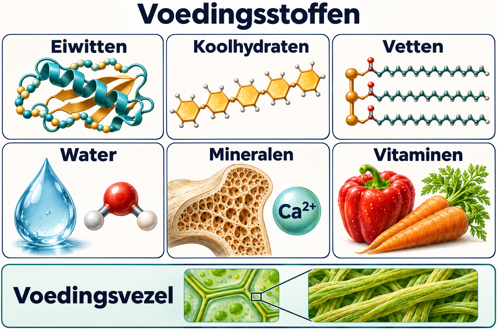

# Thema 10 Voeding en vertering - Havo 5

## Basisstof 1 Voedingsstoffen

### Samenvatting

Voedingsmiddelen leveren voedingsstoffen die het lichaam gebruikt als bouwstof, brandstof of reservestof. Welke functie een stof vervult, hangt af van haar eigenschappen en van wat de cellen op dat moment nodig hebben. Voedingsvezels ondersteunen de darmwerking.

### Lesdoelen

**Concept:** Voedingsmiddel, voedingsstof, essentiële voedingsstof, energiereserve en voedingsvezel.

**Vaardigheid:** De bouw van voedingsstoffen koppelen aan hun functies en uitleggen wat er bij een overschot gebeurt.

Je kunt de kenmerken en functies van de zes groepen voedingsstoffen en van voedingsvezels beschrijven.

### Lesinhoud

#### Van voedingsmiddel naar cel

Brood is een **voedingsmiddel**. Het levert onder andere zetmeel, een **voedingsstof**. Na vertering en opname kan het lichaam glucose gebruiken voor de **dissimilatie**, waarbij energie beschikbaar komt voor bijvoorbeeld beweging en actief transport. Bij **voortgezette assimilatie** maakt het lichaam uit opgenomen stoffen eigen organische stoffen, zoals spiereiwitten. Overtollige energie kan worden opgeslagen. Glycogeen vormt een beperkte voorraad in lever en spieren. Vetweefsel is de belangrijkste energiereserve voor langere tijd.

| Groep | Kenmerken en functies |
|---|---|
| Eiwitten | Bestaan uit aminozuren. Eiwitten geven bijvoorbeeld stevigheid aan weefsel (collageen), vervoeren stoffen, dragen signalen over of werken als enzym. Bij een overschot kunnen aminozuren worden afgebroken en de overgebleven koolstofverbindingen worden gebruikt als brandstof of omgezet in andere stoffen. |
| Koolhydraten | Glucose is een belangrijke brandstof. Suikers zijn ook bouwstenen van onder andere DNA en ATP. Bij een overschot kan glucose worden opgeslagen als glycogeen of bijdragen aan vetopslag. |
| Vetten en andere lipiden | Triglyceriden dienen als brandstof en reserve. Fosfolipiden en cholesterol zijn bestanddelen van membranen. Vet in de voeding ondersteunt de opname van de vetoplosbare vitaminen A, D, E en K. |
| Water | Hoofdbestanddeel van cellen en lichaamsvloeistoffen. Water is oplosmiddel en transportmiddel. De hoeveelheid opgeloste deeltjes bepaalt mede de osmotische waarde. |
| Mineralen | Anorganische voedingsstoffen. Calcium en fosfaat dragen bij aan de hardheid van bot en tandbeen. Spoorelementen, zoals ijzer en jodium, heb je in kleine hoeveelheden nodig, bijvoorbeeld voor hemoglobine en schildklierhormonen. |
| Vitaminen | Organische stoffen die je in kleine hoeveelheden nodig hebt. Sommige helpen enzymen hun werk te doen. Een tekort kan een gebreksziekte veroorzaken. Een te hoge inname kan ook schadelijk zijn. Provitamine A in wortel kan worden omgezet in vitamine A. |

#### Essentiële aminozuren en vetzuren

**Essentieel** betekent dat het lichaam een stof niet in voldoende mate zelf kan aanmaken. Die stof moet je daarom via de voeding opnemen. Voorbeelden zijn bepaalde aminozuren en de vetzuren linolzuur en alfa-linoleenzuur.

Een **verzadigd vetzuur** heeft alleen enkelvoudige bindingen tussen de koolstofatomen in de keten. Een **onverzadigd vetzuur** heeft één of meer dubbele bindingen. Boter bevat naar verhouding veel verzadigde vetzuren. In bijvoorbeeld olijfolie, zonnebloemolie en vette vis zitten naar verhouding veel onverzadigde vetzuren.

Het lichaam maakt het grootste deel van zijn **cholesterol** zelf, onder meer in de lever. Cholesterol is nodig voor celmembranen en dient als uitgangsstof voor onder andere steroïdhormonen, galzuren en vitamine D.

#### Voedingsvezels

Onze eigen verteringsenzymen breken **voedingsvezels** uit plantaardig voedsel niet af. Sommige vezels houden water vast. Ze kunnen daardoor bijdragen aan een soepele ontlasting en een verzadigd gevoel. Darmbacteriën kunnen een deel van de vezels afbreken.

### Belangrijke begrippen

- **Bouwstof** — Stof die het lichaam gebruikt voor groei, onderhoud en herstel.
- **Brandstof** — Stof waaruit bij dissimilatie energie beschikbaar komt.
- **Reservestof** — Stof die het lichaam opslaat voor later gebruik.
- **Essentiële voedingsstof** — Stof die het lichaam niet voldoende kan maken en die uit voeding moet komen.
- **Voedingsvezel** — Plantaardig voedingsbestanddeel dat menselijke verteringsenzymen niet kunnen afbreken.

### Praktische toepassingen

Een maaltijd met peulvruchten, volkorenbrood en olijfolie levert onder andere eiwitten voor de aanvoer van aminozuren, koolhydraten als brandstof, onverzadigde vetzuren en vezels. Eén voedingsmiddel kan dus meerdere groepen voedingsstoffen leveren.

### Zelftest

1. Leg met brood en zetmeel het verschil uit tussen een voedingsmiddel en een voedingsstof.
2. Noem de zes groepen voedingsstoffen.
3. Geef een voorbeeld van een koolhydraat als brandstof en als reservestof.
4. Waarom moet een essentieel aminozuur in het voedsel zitten?
5. Welk verschil in bouw herken je tussen een verzadigd en een onverzadigd vetzuur?
6. Waarom kan een tekort aan vet in de voeding de opname van bepaalde vitaminen verminderen?
7. Leg uit waarom voedingsvezels de dikke darm kunnen bereiken.

#### Antwoorden

1. Brood is het voedingsmiddel dat je eet. Zetmeel is een stof die brood bevat en na vertering energie kan leveren.
2. Eiwitten, koolhydraten, vetten, water, mineralen en vitaminen.
3. Glucose is een brandstof. Glycogeen is een reservestof.
4. Het lichaam kan dat aminozuur niet of niet in voldoende hoeveelheid zelf aanmaken.
5. Een onverzadigd vetzuur heeft minstens één dubbele binding tussen koolstofatomen in de keten. Een verzadigd vetzuur heeft daar alleen enkelvoudige bindingen.
6. De vitaminen A, D, E en K zijn vetoplosbaar. Vet in de voeding ondersteunt hun opname.
7. Menselijke verteringsenzymen breken deze vezels niet af. In de dikke darm kunnen bacteriën een deel ervan afbreken.

### Referentie

[Samenvatting Thema 10 Voeding en vertering](../samenvattingen/T10-Voeding-en-vertering-samenvatting.pdf), basisstof 1, gedrukte pagina’s 190–191.

Op pagina 190 staan de voorbeelden bij verzadigde en onverzadigde vetzuren omgewisseld. Roomboter bevat relatief veel verzadigde vetzuren. Olijfolie, zonnebloemolie en vette vis bevatten relatief veel onverzadigde vetzuren. [Voedingscentrum – Vetten](https://www.voedingscentrum.nl/encyclopedie/vetten.aspx)

### Afbeelding: de zes groepen voedingsstoffen

#### Tekstbeschrijving van de afbeelding

De afbeelding vergelijkt zes groepen voedingsstoffen. De aminozuurketen is gevouwen tot een eiwit. Gekoppelde suikerringen stellen een koolhydraat voor. De lange staarten stellen vetzuren voor. Een watermolecuul bestaat uit twee waterstofatomen en één zuurstofatoom. Bot laat zien waar het mineraal calcium voorkomt. Groenten zijn een bron van vitaminen. Plantaardige celwanden onderaan zijn een voorbeeld van waar voedingsvezels voorkomen.
