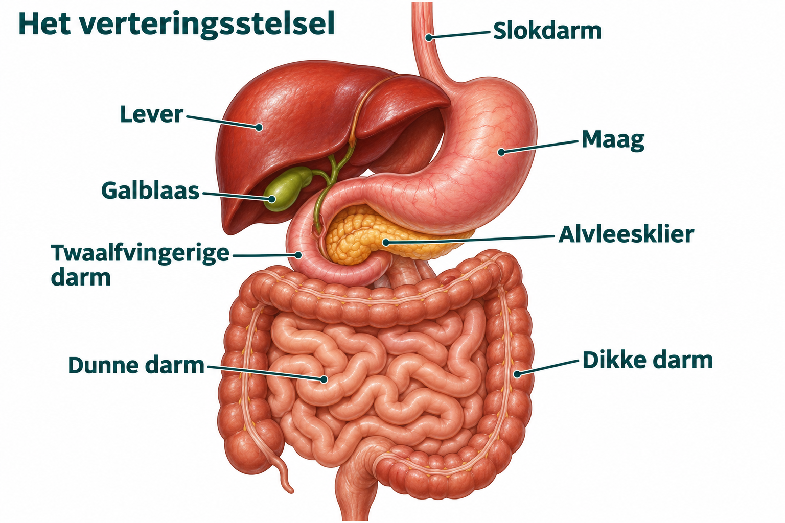

# Thema 10 Voeding en vertering - Havo 5

## Basisstof 2 Het verteringsstelsel

### Samenvatting

Spieren verplaatsen en mengen het voedsel in het darmkanaal. Mechanische vertering verkleint de voedseldeeltjes. Enzymen in verteringssappen breken grote moleculen af tot kleinere deeltjes die het lichaam kan opnemen.

### Lesdoelen

**Concept:** Darmkanaal, peristaltiek, verteringsklier, mechanische en chemische vertering.

**Vaardigheid:** De bouw van verteringsorganen koppelen aan hun functie en vertering bij verschillende organismen vergelijken.

Je kunt de route van voedsel volgen, de werking van de organen uitleggen en intracellulaire en extracellulaire vertering onderscheiden.

### Lesinhoud

#### Twee vormen van vertering

Bij **mechanische vertering** worden voedseldeeltjes verkleind, gekneed of gemengd. Daardoor wordt het oppervlak waarop enzymen kunnen inwerken groter. Bij **chemische vertering** verbreken enzymen bindingen in grote moleculen. Zo ontstaan kleinere verteringsproducten die darmepitheelcellen kunnen opnemen.

#### Van mond tot dunne darm

| Onderdeel | Bouw en werking |
|---|---|
| Mondholte | Het gebit bijt af en maalt. Speekselklieren geven speeksel af. De tong helpt het voedsel mengen en brengt het naar de keelholte. |
| Keelholte | Bij de slikreflex sluit het zachte gehemelte de neusholte af. Het strotklepje helpt de toegang tot de luchtpijp af te sluiten. |
| Slokdarm | Spieren duwen de voedselbrok naar de maag. |
| Maag | Slaat voedsel tijdelijk op, kneedt het en mengt het met maagsap. Sluitspieren regelen de doorgang. De maagportier geeft kleine hoeveelheden voedselbrij door. Zoutzuur zorgt voor een zuur milieu en doodt veel bacteriën. Slijm beschermt de maagwand. |
| Lever en galblaas | De lever maakt gal. De galblaas slaat gal tijdelijk op en geeft het via de galbuis af aan de twaalfvingerige darm. Gal bevat galzouten en galkleurstoffen. |
| Alvleesklier | Geeft alvleessap met verteringsenzymen en bicarbonaat af aan de twaalfvingerige darm. |
| Dunne darm | Begint bij de twaalfvingerige darm, waar gal en alvleessap zich mengen met voedselbrij. De darmwand levert darmsap en bevat enzymen die vertering voltooien. De meeste opname gebeurt hier. |
| Dikke darm en endeldarm | De dikke darm neemt onder meer water en zouten op. De endeldarm bewaart ontlasting totdat die via de anus naar buiten gaat. |

**Peristaltiek** is het gecoördineerd samentrekken en ontspannen van kring- en lengtespieren. Kringspieren verkleinen de diameter van de darm wanneer ze samentrekken. Lengtespieren verkorten plaatselijk een darmsegment. Samen verplaatsen ze de voedselbrij. Bewegingen van de darmwand helpen de voedselbrij ook mengen met verteringssappen.

#### Vertering bij andere organismen

Bij **intracellulaire vertering** vindt de afbraak binnen een cel plaats. Een amoebe kan een voedseldeeltje omsluiten en het via **fagocytose** opnemen. Daarbij ontstaat een **voedingsvacuole**, waarin enzymen het voedsel afbreken.

Bij **extracellulaire vertering** vindt de afbraak buiten cellen plaats, bijvoorbeeld in het darmkanaal van de mens. Ook de maag-darmholte van een zoetwaterpoliep biedt ruimte voor extracellulaire vertering. Bij de poliep dient dezelfde opening voor opname van voedsel en afvoer van onverteerde resten. Bij de mens loopt het darmkanaal van mond tot anus.

### Belangrijke begrippen

- **Peristaltiek** — Spierbewegingen die de inhoud door het darmkanaal verplaatsen.
- **Verteringsklier** — Klier die stoffen aan het darmkanaal afgeeft voor de vertering.
- **Emulgeren** — Grote vetdruppels verdelen in kleine druppels, zodat hun gezamenlijke oppervlak groter wordt.
- **Fagocytose** — Opname van een vast deeltje door omsluiting met celmembraan.
- **Voedingsvacuole** — Blaasje in een cel waarin opgenomen voedsel kan worden verteerd.

### Praktische toepassingen

Goed kauwen verdeelt een stukje brood in kleine deeltjes en mengt ze met speeksel. Daardoor kan amylase op een groter deel van het zetmeel inwerken.

### Zelftest

1. Hoe helpt mechanische vertering de werking van enzymen?
2. Hoe helpen kring- en lengtespieren de voedselbrij verplaatsen?
3. Welke twee structuren helpen voorkomen dat voedsel bij het slikken in de neus of luchtpijp komt?
4. Welke functies hebben zoutzuur en slijm in de maag?
5. Welk orgaan maakt gal, welk orgaan bewaart het en waar komt het de darm binnen?
6. Leg met de voedingsvacuole uit waarom de vertering van een amoebe intracellulair heet.
7. Hoe verschilt de maag-darmholte van een zoetwaterpoliep van het menselijke darmkanaal?

#### Antwoorden

1. Kleine voedseldeeltjes hebben samen een groter contactoppervlak. Enzymen kunnen daardoor beter bij de moleculen in het voedsel komen.
2. Kringspieren vernauwen het kanaal. Lengtespieren verkorten plaatselijk een segment. Door de gecoördineerde spierbewegingen schuift de voedselbrij vooruit.
3. Het zachte gehemelte sluit de neusholte af. Het strotklepje helpt de luchtweg sluiten.
4. Zoutzuur verlaagt de pH en doodt veel bacteriën. Slijm beschermt de maagwand.
5. De lever maakt gal, de galblaas slaat het op en de galbuis voert het naar de twaalfvingerige darm.
6. Het voedseldeeltje zit in een blaasje binnen de cel. Enzymen breken het voedsel daar af.
7. De poliep gebruikt één opening voor opname en afvoer. Bij de mens zijn mond en anus afzonderlijke openingen.

### Referentie

[Samenvatting Thema 10 Voeding en vertering](../samenvattingen/T10-Voeding-en-vertering-samenvatting.pdf), basisstof 2, gedrukte pagina 191.

### Afbeelding: het menselijke verteringsstelsel

#### Tekstbeschrijving van de afbeelding

De slokdarm loopt van de keel naar de maag. De maag komt uit in de twaalfvingerige darm. De lever ligt boven in de buik met de galblaas eronder. De alvleesklier ligt achter de maag, met de kop in de bocht van de twaalfvingerige darm. De lussen van de dunne darm liggen grotendeels binnen het kader dat de dikke darm vormt.
