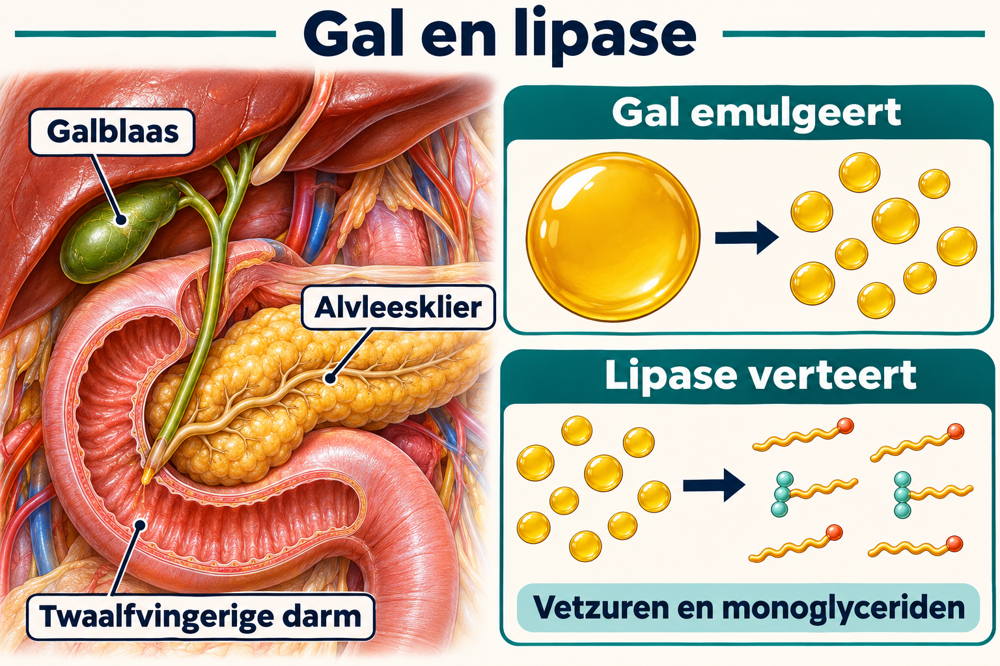

# Thema 10 Voeding en vertering - Havo 5

## Basisstof 3 Chemische vertering

### Samenvatting

Elk verteringsenzym werkt op een bepaald substraat en heeft een pH waarbij het het beste werkt. Speeksel, maagsap, alvleessap en enzymen aan de darmwand werken achtereenvolgens op koolhydraten, eiwitten en vetten. Gal vergroot het contactoppervlak voor lipase door vet te emulgeren.

### Lesdoelen

**Concept:** Verteringssap, substraat, pH-optimum, pro-enzym en emulgeren.

**Vaardigheid:** Afleiden waar een enzym werkt en voorspellen hoe veranderingen in pH of contactoppervlak de vertering beïnvloeden.

Je kunt per voedingsstof uitleggen waar enzymen werken, welke producten ontstaan en hoe het lichaam de omstandigheden voor deze enzymen regelt.

### Lesinhoud

#### Mond, maag en twaalfvingerige darm

- **Mond.** Speeksel bevat slijm, waardoor je voedsel gemakkelijker inslikt, en amylase. Het autonome zenuwstelsel regelt de speekselafgifte. Speekselamylase werkt het best rond pH 6 à 7.
- **Maag.** Maagsap bevat zoutzuur, slijm en **pepsinogeen**. Pepsinogeen is een inactieve voorloper van pepsine. In het zure milieu wordt een deel geactiveerd. Actieve pepsine zet vervolgens meer pepsinogeen om in pepsine. Dat is **positieve terugkoppeling**. Pepsine werkt het best in een sterk zuur milieu, ongeveer pH 2 à 3.
- **Twaalfvingerige darm.** Zure maaginhoud stimuleert de afgifte van bicarbonaatrijk alvleessap. Bicarbonaat neutraliseert een deel van het zuur, waardoor enzymen uit de alvleesklier beter kunnen werken. Een zure inhoud in de twaalfvingerige darm remt ook de verdere maaglediging. Vet in de brij stimuleert de afgifte van gal uit de galblaas en van enzymrijk alvleessap.

#### Welke enzymen werken waar?

| Plaats | Enzym | Substraat | Belangrijkste producten |
|---|---|---|---|
| Mond en dunne darm | Amylase uit speeksel of alvleessap | Zetmeel | Maltose en andere korte koolhydraatketens |
| Maag | Pepsine | Eiwitten | Polypeptiden |
| Dunne darm | Trypsine uit de alvleesklier en andere peptidasen | Polypeptiden en kortere peptiden | Kortere peptiden en uiteindelijk aminozuren |
| Dunne darm, bij de darmwand | Maltase, sacharase en lactase | Respectievelijk maltose, sacharose en lactose | Monosachariden, zoals glucose |
| Dunne darm | Lipase uit de alvleesklier | Triglyceriden | Vooral vrije vetzuren en monoglyceriden |

De laatste stappen van de vertering van koolhydraten en eiwitten vinden onder andere plaats met enzymen aan het oppervlak van het darmepitheel. Sommige korte peptiden worden opgenomen en pas in darmepitheelcellen verder afgebroken.

#### Waarom helpt gal bij vetvertering?

**Galzouten** verdelen een grote vetdruppel in kleinere druppels en houden die verdeeld in de waterige voedselbrij. Bij gelijk volume hebben kleine druppels samen een groter oppervlak. Lipase kan daardoor op meer plaatsen tegelijk bindingen in triglyceriden verbreken. Galzouten helpen de verteringsproducten ook in kleine deeltjes, **micellen**, naar het oppervlak van de darmwand te brengen.

### Belangrijke begrippen

- **Substraat** — Stof waarop een bepaald enzym inwerkt.
- **pH-optimum** — pH waarbij een enzym onder gegeven omstandigheden het actiefst is.
- **Pro-enzym** — Inactieve voorloper die eerst moet worden geactiveerd.
- **Emulgeren** — Een vloeistof in kleine druppels verdelen in een andere vloeistof.
- **Positieve terugkoppeling** — Een proces versterkt zichzelf doordat het product verdere productie stimuleert.

### Praktische toepassingen

Vergelijk twee reageerbuizen met evenveel zetmeel en speekselamylase. Bij pH 7 verwacht je snellere zetmeelafbraak dan bij pH 2, zolang de temperatuur en hoeveelheden gelijk zijn. Met jodiumoplossing kun je achteraf vergelijken hoeveel zetmeel aanwezig is.

### Zelftest

1. Hoe helpt slijm in speeksel bij het inslikken van voedsel?
2. Waarom werkt pepsine in de maag veel beter dan in een neutraal milieu?
3. Leg uit waarom activering van pepsinogeen door pepsine positieve terugkoppeling is.
4. Geef de route van zetmeel naar glucose met de twee betrokken enzymen.
5. Leg uit hoe bicarbonaat de omstandigheden voor vertering in de twaalfvingerige darm verbetert.
6. Waarom versnelt emulgeren de werking van lipase?
7. Iemand maakt weinig lactase. Welke stof blijft daardoor langer in de voedselbrij aanwezig?

#### Antwoorden

1. Slijm maakt de voedselbrok glad en bevochtigt die.
2. Pepsine heeft zijn pH-optimum in een sterk zuur milieu.
3. Gevormde pepsine activeert meer pepsinogeen. Daardoor ontstaat nog meer pepsine.
4. Amylase breekt zetmeel af tot onder meer maltose. Maltase splitst maltose in glucose.
5. Bicarbonaat neutraliseert een deel van het maagzuur. De pH stijgt en enzymen uit de alvleesklier komen dichter bij hun pH-optimum.
6. Kleine vetdruppels hebben samen een groter oppervlak, waardoor meer triglyceriden tegelijk in contact komen met lipase.
7. Lactose.

### Referentie

[Samenvatting Thema 10 Voeding en vertering](../samenvattingen/T10-Voeding-en-vertering-samenvatting.pdf), basisstof 3, gedrukte pagina’s 191–192.

### Afbeelding: gal en lipase

#### Tekstbeschrijving van de afbeelding

Links zie je de galblaas bij de lever, de alvleesklier en de twaalfvingerige darm. Gal en alvleessap komen via afvoerbuizen bij de darm. Rechtsboven wordt één grote vetdruppel verdeeld in meerdere kleine druppels. Rechtsonder zie je dat lipase moleculen in de druppels afbreekt. Daarbij ontstaan vooral vrije vetzuren en monoglyceriden.
