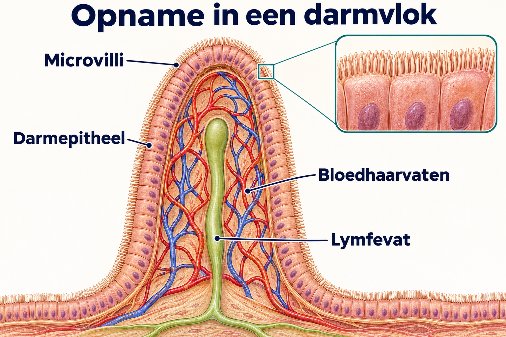

# Thema 10 Voeding en vertering - Havo 5

## Basisstof 4 Resorptie

### Samenvatting

De meeste voedingsstoffen worden opgenomen in de dunne darm. Darmplooien, darmvlokken en microvilli vergroten het contactoppervlak. Vanuit het darmepitheel komen veel stoffen in het bloed terecht. Het grootste deel van de opgenomen langeketenvetten bereikt eerst de lymfe.

### Lesdoelen

**Concept:** Resorptie, darmepitheel, darmvlok, microvilli, membraantransport en poortader.

**Vaardigheid:** Vanuit de bouw van een darmvlok verklaren hoe opname en afvoer verlopen.

Je kunt uitleggen waar voedingsstoffen worden opgenomen, welke transportroutes er zijn en waardoor de opname efficiënter wordt.

### Lesinhoud

#### Drie manieren om het oppervlak te vergroten

De wand van de dunne darm heeft **darmplooien**. Daarop staan **darmvlokken**. Elke darmvlok is bedekt met één laag **darmepitheelcellen**. Aan de kant van de darmholte heeft elke cel veel **microvilli**. Dat zijn uitstulpingen van het celmembraan. Door deze drie vergrotingen kan een groot oppervlak tegelijk stoffen opnemen. De dunne cellaag en haarvaten dicht bij het oppervlak houden de afstand voor transport klein.

#### Van darmholte naar bloed of lymfe

Bij **resorptie** passeren water en opgeloste stoffen de darmwand en bereiken ze het bloed of de lymfe.

- **Passief transport.** Deeltjes bewegen met hun concentratiegradiënt mee. Dat kan door eenvoudige diffusie of met hulp van een membraaneiwit. Water volgt osmotische verschillen.
- **Actief transport.** Met energie kan een stof tegen haar concentratiegradiënt in worden opgenomen. Een darmepitheelcel kan bijvoorbeeld glucose samen met natrium opnemen. De energie komt indirect van een pomp die ATP gebruikt om het natriumverschil in stand te houden.

Monosachariden en aminozuren bereiken de bloedhaarvaten van de darmvlokken. Veel vitamines en mineralen bereiken uiteindelijk ook het bloed. Via de **poortader** stroomt bloed van de darmen eerst naar de lever. Die kan bijvoorbeeld glucose opnemen en opslaan als glycogeen.

Langeketenvetzuren en monoglyceriden worden in epitheelcellen opnieuw samengevoegd tot triglyceriden. De cel verpakt ze met andere lipiden en eiwitten in **chylomicronen**. Die gaan eerst naar het lymfevat in de darmvlok. Via de lymfe bereiken ze later het bloed. Kortere vetzuren kunnen rechtstreeks in het bloed terechtkomen.

#### Dikke darm, blindedarm en endeldarm

De blindedarm ligt aan het begin van de dikke darm. Hieraan zit de **appendix**, het wormvormig aanhangsel. Bij een blindedarmontsteking is meestal de appendix ontstoken.

De dikke darm neemt onder meer water en zouten op. **Darmbacteriën** breken een deel van de onverteerde vezels af. Daarbij kunnen korte vetzuren ontstaan die worden opgenomen. Sommige bacteriën maken ook vormen van vitamine K. Bij diarree kan er te veel water in de darminhoud achterblijven. De **endeldarm** verzamelt ontlasting, die via de anus het lichaam verlaat. Kringspieren regelen het openen en sluiten van de anus.

### Belangrijke begrippen

- **Darmvlok** — Uitstulping van de wand van de dunne darm met bloedhaarvaten en een lymfevat.
- **Microvillus** — Uitstulping van het membraan van één epitheelcel.
- **Resorptie** — Opname van stoffen vanuit het darmkanaal in het bloed of de lymfe.
- **Poortader** — Bloedvat dat bloed uit onder andere de darmen naar de lever brengt.
- **Chylomicron** — Deeltje dat in darmepitheelcellen wordt gevormd en vetten via de lymfe vervoert.

### Praktische toepassingen

Bij afvlakking van de darmvlokken wordt het totale opnameoppervlak kleiner. Daardoor kan het lichaam bij dezelfde voedselinname minder voedingsstoffen opnemen. Dit illustreert hoe de vorm van een orgaan zijn werking bepaalt.

### Zelftest

1. Welke drie structuren vergroten het oppervlak van de dunne darm?
2. Verklaar waarom een dun epitheel gunstig is voor de opname.
3. Leg het verschil uit tussen passief en actief transport.
4. Via welke route gaat glucose vanuit de darmvlok naar de lever?
5. Beschrijf drie stappen vanaf de opname van langeketenvetzuren in een epitheelcel tot hun komst in het bloed.
6. Waarom bevat ontlasting bij diarree meer water?
7. Wat doen darmbacteriën met een deel van de vezels die in de dikke darm aankomen?

#### Antwoorden

1. Darmplooien, darmvlokken en microvilli.
2. De afstand die stoffen vanaf de darmholte naar bloed of lymfe afleggen is klein.
3. Passief transport gaat met de gradiënt mee. Bij actief transport kan een stof met behulp van energie tegen de gradiënt in worden verplaatst.
4. Glucose gaat van de epitheelcel naar een bloedhaarvat van de darmvlok en stroomt via de poortader naar de lever.
5. In de cel worden triglyceriden gevormd. De cel verpakt ze in chylomicronen die het lymfevat ingaan. Vanuit de lymfe komen de deeltjes later in het bloed.
6. Er blijft meer water in de darminhoud achter, bijvoorbeeld doordat minder water wordt opgenomen.
7. Ze zetten een deel van de vezels om in kleinere stoffen, waaronder korte vetzuren die kunnen worden opgenomen.

### Referentie

[Samenvatting Thema 10 Voeding en vertering](../samenvattingen/T10-Voeding-en-vertering-samenvatting.pdf), basisstof 4, gedrukte pagina 192.

### Afbeelding: doorsnede van een darmvlok

#### Tekstbeschrijving van de afbeelding

De darmvlok steekt de darmholte in. Aan de buitenkant ligt één laag darmepitheelcellen. De vergroting toont korte microvilli aan de kant van de darmholte. Onder het epitheel ligt een vertakt netwerk van bloedhaarvaten. Het afzonderlijke lymfevat ligt centraal. Glucose en aminozuren gaan vooral naar de haarvaten. Het grootste deel van de opgenomen langeketenvetten gaat in chylomicronen naar het lymfevat.
