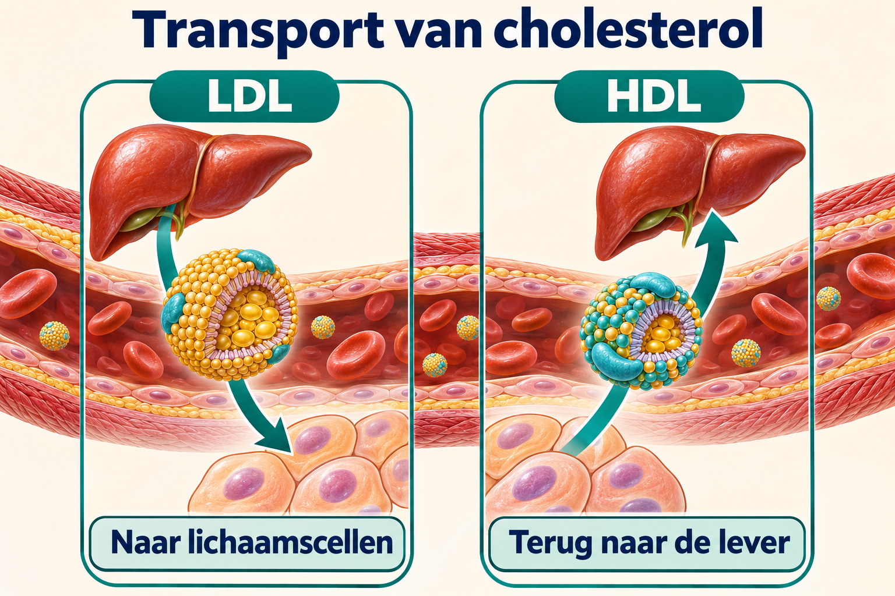

# Thema 10 Voeding en vertering - Havo 5

## Basisstof 5 Gezonde voeding (SE)

### Samenvatting

Een voedingspatroon moet genoeg energie en voedingsstoffen leveren. Voeding en beweging beïnvloeden de energiebalans. Ook de samenstelling van je voeding telt mee. Verzadigde en onverzadigde vetzuren hebben bijvoorbeeld verschillende effecten op het LDL-cholesterol. Voedselproductie heeft daarnaast gevolgen voor het milieu.

### Lesdoelen

**Concept:** Voedingspatroon, energiebalans, BMI, tailleomtrek, LDL en HDL.

**Vaardigheid:** Voedingskeuzes beoordelen aan de hand van samenstelling, energiebalans, risicofactoren en milieu-impact.

Je kunt kenmerken van een verantwoord voedingspatroon noemen en verklaren hoe een langdurig energieoverschot en een verhoogd LDL-cholesterol samenhangen met gezondheidsrisico’s.

### Lesinhoud

#### Voedingspatroon beoordelen

Met de **Schijf van Vijf** kun je een voedingspatroon beoordelen. Een gevarieerd patroon bevat onder andere groente, fruit, volkorenproducten en andere voedingsmiddelen die passen bij de behoefte aan energie en voedingsstoffen. Veel sterk bewerkte producten leveren relatief veel zout, toegevoegde suiker of verzadigd vet en weinig vezels. Bekijk bij een vergelijking het etiket en de hoeveelheid die je eet. Voedingswaarden per 100 gram maken producten van dezelfde soort makkelijker vergelijkbaar.

#### Energiebalans, BMI en tailleomtrek

De **energiebalans** is het verschil tussen energie-inname en energieverbruik. Je verbruik hangt onder meer af van lichaamsmassa, leeftijd, geslacht, omgevingstemperatuur en lichamelijke activiteit.

Bij een langdurig energieoverschot kan de vetvoorraad toenemen. Bij een langdurig energietekort spreekt het lichaam reserves aan. Veel vet rond organen in de buik hangt samen met een grotere kans op onder andere diabetes type 2 en hart- en vaatziekten.

De **BMI** bereken je met massa in kilogram gedeeld door lengte in meter in het kwadraat. Een volwassene van 72 kg en 1,80 m heeft bijvoorbeeld een BMI van 72 ÷ 1,80² ≈ 22,2 kg/m². **Tailleomtrek** geeft aanvullende informatie over de vetverdeling. Bij de interpretatie van de BMI van jongeren spelen leeftijd en geslacht mee. Ook spiermassa beïnvloedt de BMI.

#### Cholesterol en lipoproteïnen

Cholesterol is een bouwstof voor celmembranen en een uitgangsstof voor onder andere steroïdhormonen. Vervoer door bloed gebeurt met **lipoproteïnen**, deeltjes die uit lipiden en eiwitten bestaan.

- **LDL** levert cholesterol aan lichaamscellen. Langdurig veel LDL-cholesterol in het bloed bevordert ophoping van cholesterol in slagaderwanden. Dit draagt bij aan slagaderverkalking.
- **HDL** helpt cholesterol uit weefsels terug te voeren naar de lever.

Wanneer je verzadigd vet vervangt door onverzadigd vet kan het LDL-cholesterol dalen. Je berekent de **totaalcholesterol/HDL-ratio** door het totale cholesterolgehalte te delen door het HDL-cholesterolgehalte. Bij 4,8 mmol/L totaalcholesterol en 1,2 mmol/L HDL-cholesterol is de verhouding 4,0. De ratio is één aanwijzing voor het risico op hart- en vaatziekten. Andere factoren, zoals bloeddruk en roken, tellen ook mee.

#### Voedselproductie en omgeving

Voor voedselproductie zijn onder meer land, zoetwater en energie nodig. Bemesting, gewasbeschermingsmiddelen, verwerking en transport kunnen de invloed op het milieu veranderen. Bevolkingsgroei en veranderingen in welvaart beïnvloeden de voedselvraag. Vergelijk productiemethoden daarom op meerdere kenmerken, zoals opbrengst per hectare, hulpbronnen per kilogram product en voedselverlies.

### Belangrijke begrippen

- **Energiebalans** — Verschil tussen de energie die je inneemt en de energie die je verbruikt.
- **BMI** — Verhouding tussen massa en lengte volgens de formule massa ÷ lengte².
- **Tailleomtrek** — Omtrek rond de buik die informatie geeft over de vetverdeling.
- **Lipoproteïne** — Transportdeeltje dat lipiden in het bloed kan vervoeren.
- **Totaalcholesterol/HDL-ratio** — Totaalcholesterol gedeeld door HDL-cholesterol.

### Praktische toepassingen

Vergelijk twee ontbijtgranen per 100 gram. Noteer bijvoorbeeld vezels, suiker en verzadigd vet. Bereken daarna de waarden voor een normale portie. Zo kun je verklaren waarom de rangorde per 100 gram en per portie kan verschillen.

### Zelftest

1. Welke drie etiketgegevens helpen je om twee vergelijkbare ontbijtgranen te beoordelen?
2. Wat gebeurt er doorgaans met de vetvoorraad bij een langdurig energieoverschot?
3. Bereken de BMI van een volwassene van 81 kg en 1,80 m. Rond af op één decimaal.
4. Waarom geeft tailleomtrek aanvullende informatie bij de BMI?
5. Leg uit welke rol LDL en HDL elk spelen bij het vervoer van cholesterol.
6. Bereken de totaalcholesterol/HDL-ratio bij 5,4 mmol/L totaalcholesterol en 1,5 mmol/L HDL-cholesterol.
7. Noem twee meetbare kenmerken waarmee je de milieu-impact van twee productiemethoden kunt vergelijken.

#### Antwoorden

1. Bijvoorbeeld de hoeveelheden voedingsvezel, suiker en verzadigd vet per 100 gram.
2. De vetvoorraad kan toenemen doordat het lichaam een deel van de extra energie opslaat.
3. 81 ÷ 1,80² = 25,0 kg/m².
4. Tailleomtrek geeft informatie over waar vet is opgeslagen. BMI geeft alleen een verhouding tussen massa en lengte.
5. LDL levert cholesterol aan lichaamscellen. HDL helpt cholesterol vanuit weefsels naar de lever terug te brengen.
6. 5,4 ÷ 1,5 = 3,6.
7. Bijvoorbeeld hoeveel liter zoetwater en hoeveel energie per kilogram product nodig zijn.

### Referentie

- [Samenvatting Thema 10 Voeding en vertering](../samenvattingen/T10-Voeding-en-vertering-samenvatting.pdf), basisstof 5, gedrukte pagina’s 192–193.
- [Voedingscentrum – Schijf van Vijf](https://www.voedingscentrum.nl/schijfvanvijf)
- [Voedingscentrum – Cholesterol](https://www.voedingscentrum.nl/cholesterol)

### Afbeelding: transport van cholesterol

#### Tekstbeschrijving van de afbeelding

Twee panelen vergelijken de transportrichtingen. Links gaat de pijl via een LDL-deeltje naar de lichaamscellen. Rechts gaat de pijl van lichaamscellen via een HDL-deeltje terug naar de lever. De uitvergrote deeltjes hebben een buitenkant van onder andere lipiden en eiwitten en vervoeren lipiden in het bloed.
